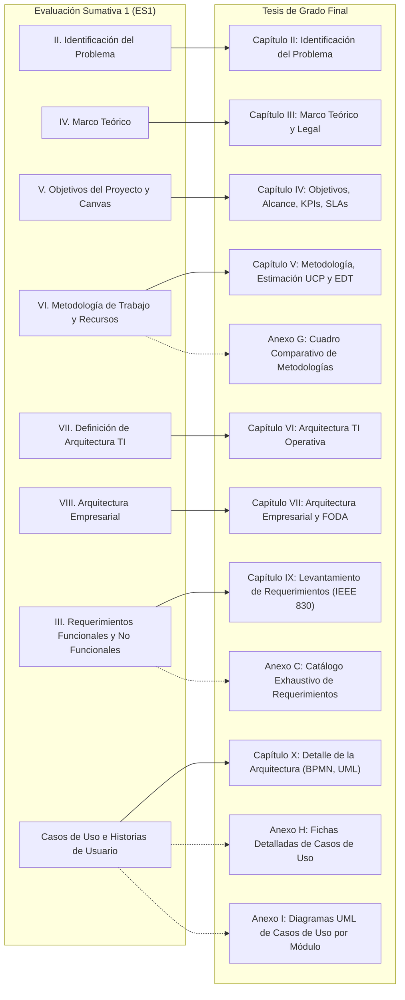

# Análisis Estructural: Evaluación Sumativa 1 (ES1) — Proyecto espaciGo

**Documentos analizados:**
- Plantilla oficial INACAP: `TIHI84_U1_Plantilla_informe_Guía_ABPro.docx` (Unidad 1: Formulación del Proyecto de Software).
- Rúbrica y Criterios: `Criterios_Evaluacion_ES1.md` (Escala de Apreciación N°1, 70 puntos totales).
- Registro de observaciones docentes: `correcciones_profesora.md` (Retroalimentación de la profesora guía Teresa Tapia).
- Informe entregado del proyecto: `informe_del_proyecto_espacigo.md` y sus artefactos de soporte (`anexo_requerimientos_funcionales.md`, `anexo_requerimientos_no_funcionales.md`, `anexo_casos_de_uso.md`, `anexo_historias_de_usuario.md`, `actores_y_modulos.md`).
- Calificación obtenida: **40 / 70 puntos (Nota 4.0 aprox.)**.

---

## 1. Estructura Formal de la Plantilla Institucional (TIHI84 - U1)

La plantilla institucional de INACAP establece la siguiente estructura obligatoria para la Evaluación Sumativa 1:

```
PRELIMINARES
├── Portada Oficial Institucional (Carrera, Asignatura, Título, Integrantes, Profesor Guía, Fecha)
├── Índice de Contenido / Tabla de Contenido
├── Índice de Tablas
└── Índice de Figuras / Ilustraciones

CUERPO DEL INFORME (ES1)
├── I. Introducción
├── II. Identificación del Problema
│   ├── 2.1. Actualización y justificación del problema
│   │   ├── 2.1.1. Descripción de la organización
│   │   └── 2.1.2. Descripción del problema
│   └── 2.2. Justificación del problema
│       ├── 2.2.1. Relevancia del problema
│       └── 2.2.2. Complejidad del problema
├── III. Levantamiento de Requerimientos
│   ├── 3.1. Requerimientos Funcionales (IEEE 830 o Historias de Usuario)
│   ├── 3.2. Requerimientos No Funcionales
│   └── 3.3. Restricciones del Sistema
├── IV. Marco Teórico
│   └── [Conceptos del dominio, tecnologías, normativas legales y estado del arte]
├── V. Objetivos del Proyecto
│   ├── 5.1. Solución tecnológica
│   │   ├── 5.1.1. Formulación de la Solución
│   │   └── 5.1.2. Alcance y restricciones
│   ├── 5.2. Impacto de la solución
│   │   ├── 5.2.1. Proceso de negocio afectado
│   │   ├── 5.2.2. Registro de Interesados
│   │   ├── 5.2.3. Indicadores de gestión (KPI)
│   │   └── 5.2.4. Niveles de servicio (SLA/OLA)
│   └── 5.3. Objetivos del proyecto
│       ├── 5.3.1. Objetivo General
│       └── 5.3.2. Objetivos Específicos
├── VI. Metodología de Trabajo
│   ├── 6.1. Metodología de Desarrollo de la solución
│   ├── 6.2. Duración y cronograma
│   ├── 6.3. Equipo de trabajo
│   └── 6.4. Plan de recursos
├── VII. Definición de arquitectura TI
│   └── [Infraestructura, conectividad, herramientas de desarrollo, repositorios]
├── VIII. Reconocimiento de arquitectura empresarial
│   └── [Misión, visión, valores, estructura jerárquica y 4 dominios arquitectónicos]
├── IX. Conclusiones
├── X. Referencias bibliográficas (Norma APA 7ma Edición)
└── XI. Anexos
```

---

## 2. Rúbrica Oficial de Evaluación (Escala de Apreciación N°1 - 70 Puntos)

La evaluación se estructura en 6 dimensiones y 14 criterios específicos evaluados con 3 niveles de desempeño (*Excelente*, *Bueno*, *Insatisfactorio*):

| Dimensión | Criterio de Evaluación | Ponderación Excelente | Ponderación Bueno | Ponderación Insatisfactorio |
|---|---|:---:|:---:|:---:|
| **1.1.1 Identificación y Requerimientos** | **1.1.1.1.** Selecciona un tipo de organización para la realización del proyecto, justificando su elección acorde a estándares tecnológicos. | 3.6 pts | 2.4 pts | 0.0 pts |
| | **1.1.1.2.** Identifica el problema que será solucionado mediante el proyecto informático, considerando su relevancia y complejidad. | 6.0 pts | 4.0 pts | 0.0 pts |
| | **1.1.1.3.** Documenta los requerimientos, siguiendo el estándar IEEE 830 (predictivo) o historias de usuario (adaptativo). | 4.8 pts | 3.2 pts | 0.0 pts |
| **1.1.2 Propósito y Marco Teórico** | **1.1.2.4.** Proceso de búsqueda, análisis y selección de fuentes bibliográficas que sustenten la propuesta. | 4.8 pts | 3.2 pts | 0.0 pts |
| | **1.1.2.5.** Formula la solución sustentada en el Marco Teórico. | 3.6 pts | 2.4 pts | 0.0 pts |
| | **1.1.2.6.** Formula el objetivo general y objetivos específicos del proyecto. | 6.0 pts | 4.0 pts | 0.0 pts |
| **1.1.3 Metodología y Planificación** | **1.1.3.7.** Plantea la metodología para el desarrollo acorde al problema planteado. | 4.8 pts | 3.2 pts | 0.0 pts |
| | **1.1.3.8.** Define duración, cronograma, equipo de trabajo y plan de recursos del proyecto. | 3.0 pts | 2.0 pts | 0.0 pts |
| **1.1.4 Arquitectura TI** | **1.1.4.9.** Define la arquitectura TI verificando la necesidad de integración con otros sistemas. | 3.6 pts | 2.4 pts | 0.0 pts |
| | **1.1.4.10.** Justifica el uso de la arquitectura TI seleccionada. | 3.6 pts | 2.4 pts | 0.0 pts |
| **1.1.5 Arquitectura Empresarial** | **1.1.5.11.** Reconoce características de la arquitectura empresarial (tipo de organización y estructura). | 3.0 pts | 2.0 pts | 0.0 pts |
| | **1.1.5.12.** Define la solución de manera compatible con la arquitectura empresarial. | 3.6 pts | 2.4 pts | 0.0 pts |
| **1.1.6 Comunicación y Coherencia** | **1.1.6.13.** Utiliza un lenguaje formal y técnico en el desarrollo del proyecto. | 4.8 pts | 3.2 pts | 0.0 pts |
| | **1.1.6.14.** Demuestra coherencia en el planteamiento del problema, solución y conclusión. | 4.8 pts | 3.2 pts | 0.0 pts |
| **TOTAL** | **14 Criterios Evaluativos** | **70.0 pts** | **46.8 pts** | **0.0 pts** |

---

## 3. Radiografía de la Entrega Real de espaciGo (ES1PT)

El informe entregado (`informe_del_proyecto_espacigo.md`) presentó la siguiente estructura de cabeceras:

```
# FORMULACIÓN DEL PROYECTO DE TÍTULO: EspaciGo
├── ## Introducción
├── ## Identificación del Problema
│   └── ### Actualización y justificación del problema
├── ## Levantamiento de Requerimientos
│   ├── ### Determinación de los instrumentos a utilizar
│   ├── ### Documentar los Requerimientos
│   ├── ### Identificación de Actores del Sistema
│   ├── ### Requerimientos Funcionales (RF)
│   └── ### Requerimientos No Funcionales (RNF)
├── ## Especificación de Casos de Uso y Referencias Cruzadas (Predictivo)
│   ├── ### Módulo M01 a M11 (11 módulos funcionales)
├── ## Historias de Usuario (Metodología Adaptativa)
├── ## Matriz de Trazabilidad
├── ## Marco Teórico (11 subsecciones temáticas)
├── ## Objetivos del Proyecto (General y Específicos)
├── ## Formulación de la Solución (Alcance, restricciones, Interesados)
├── ## Metodología de Desarrollo del Proyecto (Cronograma, Equipo, Recursos)
├── ## Definición de arquitectura TI
├── ## Reconocimiento de arquitectura empresarial (Organigrama, Dominios)
└── ## Conclusiones
```

### Volumen de Artefactos Producidos en ES1PT:
- **236 Requerimientos Funcionales (RQF)** atómicos tabulados.
- **43 Requerimientos No Funcionales (RNF)**.
- **52 Casos de Uso (UC)** organizados en 11 módulos.
- **35 Historias de Usuario (HU)** agrupadas en 9 épicas con criterios de aceptación.
- **1 Matriz de Trazabilidad** cruzada entre RQF, Casos de Uso e Historias de Usuario.

---

## 4. Diagnóstico Forense: ¿Por qué la entrega obtuvo 40/70?

A través del contraste entre la rúbrica oficial, el informe entregado y las grabaciones de retroalimentación de la profesora Teresa Tapia (`correcciones_profesora.md`), se identifican con precisión las **fallas estructurales y metodológicas** que castigaron el puntaje:

### 4.1. Falla en Metodología (Criterio 1.1.3.7 — Castigo Severo)
- **El error cometido:** El grupo presentó una adopción de gestión basada en PMBOK pero **sin justificación comparativa multicriterio**.
- **La exigencia docente:** La profesora exigió que no se presente PMBOK de forma aislada ni Scrum puro. Se exige una **metodología híbrida** (ciclo iterativo-incremental en lo técnico + mejores prácticas del PMBOK en la gestión), acompañada de un **cuadro comparativo formal** (como el Anexo G de la tesis de ejemplo) que justifique con métricas por qué no se usa cascada, XP o Kanban puro en un proyecto sin cliente que altere requerimientos en caliente.

### 4.2. Colapso Estructural entre "Cuerpo vs. Anexos" (Criterio 1.1.6.14)
- **El error cometido:** Se incrustaron en el cuerpo del informe tablas masivas de 236 requerimientos, 52 casos de uso y decenas de historias de usuario. El documento se tornó ilegible, saturado y desarticulado.
- **La exigencia docente:** La profesora señaló expresamente:
  > *"En el cuerpo del informe solo van tablas resumen con ID + Nombre del requerimiento (para que quepan 25 o 30 por página). Todo el detalle extenso va a los ANEXOS, y al pie de la tabla se debe colocar: 'Para mayor detalle, ver Anexo X con la totalidad de los requerimientos funcionales'"*.

### 4.3. Diagramación de Casos de Uso Incorrecta (Criterio 1.1.1.3)
- **El error cometido:** Los diagramas de casos de uso se modelaron de forma aislada por cada caso de uso o en un diagrama gigante sin fronteras claras. Faltaban los nombres de subsistema y se mezclaron requerimientos no funcionales (como "encriptar contraseña") como si fuesen casos de uso.
- **La exigencia docente:** Se debe presentar **un diagrama UML por módulo funcional** (ej. Módulo Autenticación, Módulo Publicaciones, Módulo Pagos). Cada diagrama debe poseer el rectángulo de frontera del sistema con el nombre del módulo en la cabecera, y las fichas de casos de uso deben contar obligatoriamente con **flujo principal, flujos alternativos numerados y pre/postcondiciones**.

### 4.4. Debilidad en Arquitectura Empresarial (Criterios 1.1.5.11 y 1.1.5.12)
- **El error cometido:** El capítulo de Arquitectura Empresarial se limitó a 3 párrafos, un organigrama simple en ASCII y unas viñetas breves de dominios. No hubo matriz FODA institucional, no se definieron los objetivos estratégicos de la startup ni se modeló formalmente la arquitectura de procesos de negocio.
- **La exigencia docente:** La arquitectura empresarial debe contener la identidad corporativa completa (Misión, Visión, Valores, FODA cruzado), el organigrama con roles y responsabilidades diferenciadas (Gerencia, Operaciones/QA, Desarrollo), y el desglose de los **4 dominios de TOGAF**: Arquitectura de Procesos, Aplicaciones, Datos e Infraestructura.

### 4.5. Atomización de Verbos en Requerimientos Funcionales
- **El error cometido:** Muchos requerimientos usaban verbos compuestos o no atómicos como "gestionar galería", "administrar reservas" o "bloquear y fijar anuncios".
- **La exigencia docente:** Cada requerimiento funcional debe poseer **un único verbo atómico**: `registrar`, `consultar`, `modificar`, `eliminar`, `bloquear`, `notificar`, `descargar`.

---

## 5. Mapeo de Reubicación de ES1 hacia la Tesis Final

Para la construcción de la Tesis de Grado definitiva, el contenido de ES1 no se descarta: se **depura, reestructura y distribuye** en los capítulos y anexos correspondientes siguiendo el estándar de la tesis aprobada de referencia:



### Lecciones Aprendidas de ES1 para la Tesis Final:
1. **Nunca colocar el catálogo de 200 requerimientos en el cuerpo:** En el Capítulo IX solo va la tabla de resumen y la explicación metodológica; los 236 RFs atómicos van al **Anexo C**.
2. **Incorporar el cuadro comparativo cuali/cuantitativo de metodologías:** Debe figurar como el **Anexo G**, justificando el modelo iterativo-incremental frente a cascada, scrum y kanban.
3. **Formalizar la arquitectura empresarial en los Capítulos VI y VII:** Organigrama visual de alta fidelidad, matriz FODA y articulación de los 4 dominios arquitectónicos.
4. **Modelar los casos de uso estrictamente por módulo:** En el cuerpo solo se presentan los diagramas de arquitectura general; los diagramas por subsistema van al **Anexo I** y sus 52 fichas técnicas al **Anexo H**.
