# Análisis Estructural Exhaustivo: Tesis de Grado en Ingeniería de Software

**Documento analizado en su totalidad:** `Informe Final_JuanAstudillo_FelipeQuinehual_FranciscoRiquelme.pdf` (558 páginas, 18.265 líneas de texto plano, convertido y auditado íntegramente a través de `tesis_completa.md` y sus 13 particiones).  
**Contexto Académico:** Carrera de Tecnologías de Información y Ciberseguridad, INACAP Sede Santiago Centro (Noviembre 2025).  
**Proyecto de referencia de la tesis:** *"Busquidy: Bolsa Única de Servicios que Unifica Demandas Independientes"* (Plataforma web de Gig Economy estudiantil con pasarela de pago Escrow, matching con IA y tests psicométricos).  
**Objetivo de este análisis:** Desmontar por completo la **arquitectura documental, jerarquía de títulos, decisiones metodológicas, articulación de anexos, inventario de diagramas, gestión de proyectos y evaluación económica**, abstrayendo el tema particular para que sirva de plantilla y estándar de referencia riguroso para la construcción de una tesis de titulación de software.

---

## 1. Métricas Globales y Estilo Editorial

| Dimensión | Métrica Documentada | Observaciones Estructurales |
|---|---|---|
| **Páginas Totales** | **558 páginas** | 41 preliminares (i–xli) + 230 cuerpo principal (1–230) + 36 post-cuerpo (231–267) + 250 anexos (268–517). |
| **Volumen de Anexos** | **~45% del documento** | Los anexos contienen el detalle técnico operativo, liberando al cuerpo para el análisis y la toma de decisiones. |
| **Total de Tablas** | **134 tablas** | Numeración correlativa global única (1 a 18 en cuerpo; 19 a 134 en anexos). |
| **Total de Ilustraciones** | **58 ilustraciones** | Numeración correlativa global única (1 a 34 en cuerpo; 35 a 58 en anexos). |
| **Capítulos Formales** | **15 capítulos + 2 de cierre** | Portadas individuales dedicadas por cada capítulo antes de iniciar la sección. |
| **Anexos Clasificados** | **15 Anexos (A al O)** | Nomenclatura uniforme: `Anexo [LETRA] || [Título Descriptivo]`. |
| **Norma Editorial Base** | **APA 7ma Edición (Adaptada)** | Tablas y figuras con encabezado superior y atribución de autoría. Citas en texto formato `(Autor, Año)`. |

---

## 2. Mapa Jerárquico Completo de Títulos, Subtítulos y Secciones

A continuación se detalla la radiografía jerárquica real de toda la tesis, indicando la numeración literal, nombre del acápite, página física de inicio y el tipo de contenido que alberga.

```
PRELIMINARES (Páginas i a xli)
├── Portada Institucional (p. i) [Sin numeración visible; Membrete, Título, Subtítulo, Autores, Profesor Guía, Fecha]
├── Hoja de Aprobación y Evaluación (p. ii) [Datos del proyecto + Tabla evaluativa: Nombre | Firma | Calificación]
├── Dedicatoria (p. iii) [3 bloques individuales: Juan Astudillo, Felipe Quiñehual, Francisco Riquelme]
├── Agradecimientos (p. iv) [Agradecimiento institucional, mención al docente guía y a psicóloga asesora]
├── Tabla de Contenido (p. v - xxi) [Tres a cuatro niveles jerárquicos con líneas de puntos guía hacia la página]
├── Índice de Tablas (p. xxii - xxxii) [134 entradas: 'Tabla N Título Fuente: ... pág']
├── Índice de Figuras (p. xxxiii - xxxvii) [58 entradas: 'Ilustración N Título Fuente: ... pág']
├── Resumen (p. xxxviii - xxxix) [4 párrafos: Contexto/Problema, Solución, Metodología/UCP, Resultados Financieros]
│   └── Palabras Claves (p. xxxix) [11 términos separados por comas]
└── Abstract & Keywords (p. xl - xli) [Traducción fiel al inglés técnico]

CUERPO PRINCIPAL DE LA TESIS (Páginas 1 a 230)
├── Portadilla Capítulo I: Introducción (p. 1)
├── 1. Introducción (p. 2)
│   └── 1.1. Organización de la Tesis (p. 4) [1 párrafo descriptivo por cada uno de los capítulos subsiguientes]
│
├── Portadilla Capítulo II: Identificación del Problema (p. 7)
├── 2. Identificación del Problema (p. 8)
│   ├── 2.1. Introducción (p. 8) [Estadísticas laborales del INE, desempleo juvenil, citas a medios y estudios]
│   ├── 2.2. Descripción del Problema (p. 10)
│   │   ├── 2.2.1. Descripción General (p. 10) [Ilustración 1: Diagrama de Contexto + desglose P.1, P.2, P.3]
│   │   └── 2.2.2. Problemas Específicos (p. 16) [Tabla 1: Matriz Causa - Problema - Consecuencia]
│   ├── 2.3. Justificación del Problema (p. 19)
│   │   ├── 2.3.1. Relevancia del Problema (p. 19) [Impacto socioeconómico y tecnológico]
│   │   └── 2.3.2. Complejidad del Problema (p. 20) [Desafíos multidimensionales: confianza, pagos, perfiles]
│   └── 2.4. Descripción de la Organización (p. 23) [Contexto institucional y visión de la startup/equipo]
│
├── Portadilla Capítulo III: Marco Teórico (p. 24)
├── 3. Marco Teórico (p. 25)
│   ├── 3.1. Medios Digitales de Intermediación Laboral (p. 25)
│   │   ├── 3.1.1. Portales de Empleo (p. 25)
│   │   ├── 3.1.2. Clasificación de portales de empleo en Chile (p. 26)
│   │   │   ├── 3.1.2.1. Portales generales (p. 26)
│   │   │   ├── 3.1.2.2. Portales especializados (p. 26)
│   │   │   ├── 3.1.2.3. Bolsas laborales implementadas en universidades (p. 27)
│   │   │   ├── 3.1.2.4. Portales públicos y de servicios (p. 27)
│   │   │   └── 3.1.2.5. Otros tipos (p. 28)
│   │   ├── 3.1.3. Los portales de empleos más recomendados en Chile 2025 (p. 28) [Ranking comparativo]
│   │   └── 3.1.4. Preferencias de los usuarios en Chile (p. 29)
│   │       ├── 3.1.4.1. Portales preferidos en Chile (p. 29)
│   │       ├── 3.1.4.2. Modalidades de trabajo preferidas (p. 30)
│   │       └── 3.1.4.3. Limitaciones percibidas (p. 30)
│   ├── 3.2. Modelos de Negocio en Plataformas Laborales (p. 31)
│   │   ├── 3.2.1. Modelo de Negocio Multifacética (Multi-sided) (p. 31)
│   │   ├── 3.2.2. Modelo de Negocio Bilateral (Two-way) (p. 31)
│   │   ├── 3.2.3. Modelo de Negocio Colaborativo (Gig-economy) (p. 32)
│   │   └── 3.2.4. Modelos de monetización y seguridad transaccional (p. 34)
│   │       ├── 3.2.4.1. Sistemas de pago (p. 34) [Cuentas de depósito en garantía / Escrow]
│   │       └── 3.2.4.2. Marco legal (p. 35) [Leyes laborales, Ley Fintech 21.521, Código de Comercio]
│   ├── 3.3. Servicios y Tecnologías Utilizadas en los Portales (p. 37)
│   │   ├── 3.3.1. Video Llamadas (p. 37) [WebRTC vs Servicios Gestionados]
│   │   ├── 3.3.2. Inteligencia Artificial en el Reclutamiento (p. 37)
│   │   │   ├── 3.3.2.1. Modelos de Extracción (p. 38) [OCR y NLP para CVs]
│   │   │   ├── 3.3.2.2. Integración con Sistemas ATS y Matching Inteligente (p. 39)
│   │   │   └── 3.3.2.3. Desafíos y Consideraciones Éticas (p. 39)
│   │   └── 3.3.3. Algoritmos de Recomendación (p. 40)
│   │       ├── 3.3.3.1. Definición y Tipología de Algoritmos (p. 40)
│   │       └── 3.3.3.2. Algoritmo Utilizado para la Recomendación de Perfiles (p. 41) [Ilustración 2: Similitud Coseno]
│   ├── 3.4. Metodologías de Evaluación de Capital Humano (p. 42)
│   │   ├── 3.4.1. Importancia de las Habilidades Blandas y el Compromiso (Soft Skills). (p. 42)
│   │   │   ├── 3.4.1.1. El Compromiso Laboral (p. 43)
│   │   │   └── 3.4.1.2. La Responsabilidad (Accountability) (p. 43)
│   │   └── 3.4.2. Cuestionarios de Evaluación y Pruebas de Perfil (p. 44)
│   │       ├── 3.4.2.1. Tipos de instrumentos de Evaluación (p. 44)
│   │       └── 3.4.2.2. Metodología de Operacionalización para el Proyecto (p. 45) [Diseño de test psicométrico]
│   └── 3.5. Implicancias para la Propuesta de Busquidy (p. 47)
│       ├── 3.5.1. Evidencia Cuantitativa de la Brecha (p. 47)
│       ├── 3.5.2. Modelo de Negocio y Respuesta Tecnológica (p. 48)
│       └── 3.5.3. Validación de Confianza y Habilidades Blandas (p. 48)
│
├── Portadilla Capítulo IV: Objetivos del Proyecto (p. 50)
├── 4. Objetivos del Proyecto (p. 51)
│   ├── 4.1. Solución Tecnológica (p. 51)
│   │   ├── 4.1.1. Formulación de la Solución (p. 51) [Listado de características y funcionalidades clave]
│   │   ├── 4.1.2. Modelo de Negocio de la Solución (p. 52) [Ilustración 3: Lienzo Canvas completo]
│   │   └── 4.1.3. Alcance y Restricciones. (p. 53) [Alcance inicial + Restricciones: Temporal, Tecnológica, Idioma...]
│   ├── 4.2. Impacto de la solución (p. 57)
│   │   ├── 4.2.1. Proceso de Negocio Afectado (p. 57)
│   │   │   ├── 4.2.1.1. Impacto en el Proceso de Reclutamiento y Contratación (p. 57)
│   │   │   ├── 4.2.1.2. Impacto en el Proceso de Búsqueda de Empleo para Estudiantes (p. 58)
│   │   │   ├── 4.2.1.3. Impacto en el Proceso de Gestión de Tareas y Proyectos (p. 58)
│   │   │   └── 4.2.1.4. Impacto en el Proceso de Confianza y Reputación (p. 59)
│   │   ├── 4.2.2. Registro de Interesados (p. 60) [Tabla 2: Matriz resumida de stakeholders -> Ref. Anexo A]
│   │   ├── 4.2.3. Indicadores de Gestión (p. 61) [Tabla 3: KPIs de éxito de negocio y metas -> Ref. Anexo D]
│   │   └── 4.2.4. Niveles de Servicio (p. 62) [Tabla 4: SLAs; Tabla 5: OLAs -> Ref. Anexo B]
│   └── 4.3. Objetivos del Proyecto (p. 63)
│       ├── 4.3.1. Objetivo General (p. 63)
│       └── 4.3.2. Objetivos Específicos (p. 63) [17 objetivos redactados con taxonomía de Bloom]
│
├── Portadilla Capítulo V: Metodología de Trabajo (p. 65)
├── 5. Metodología de Trabajo (p. 66)
│   ├── 5.1. Metodología y Desarrollo de la Solución. (p. 66) [Selección Iterativa/Incremental + Estimación Dual UCP vs EDT]
│   ├── 5.2. Duración y Cronograma. (p. 69) [5 fases de ciclo de vida con fechas de inicio y término]
│   ├── 5.3. Equipo de Trabajo. (p. 71) [3 roles formales: Jefe de Proyecto, Desarrollador Full Stack, UX/QA]
│   └── 5.4. Plan de Recursos. (p. 73) [Alineado al PMBOK]
│       ├── 5.4.1. Planificar la Gestión de Recursos (p. 73)
│       ├── 5.4.2. Estimar y Adquirir Recursos (p. 73)
│       ├── 5.4.3. Desarrollar y Dirigir al Equipo (p. 74)
│       └── 5.4.4. Controlar los Recursos (p. 75)
│
├── Portadilla Capítulo VI: Definición de Arquitectura TI (p. 76)
├── 6. Definición de Arquitectura TI (p. 77)
│   └── 6.1. Especificación de Arquitectura (p. 77)
│       ├── 6.1.1. Arquitectura de Infraestructura y Conectividad (p. 77) [Ilustración 4: Topología operativa de desarrollo]
│       ├── 6.1.2. Arquitectura de Aplicaciones (Herramientas Operativas) (p. 79)
│       ├── 6.1.3. Arquitectura de Datos (Repositorios Empresariales) (p. 80)
│       └── 6.1.4. Estructura Organizacional y Roles (p. 81) [Ilustración 5: Organigrama jerárquico]
│
├── Portadilla Capítulo VII: Reconocimiento de Arquitectura Empresarial (p. 82)
├── 7. Reconocimiento de Arquitectura Empresarial (p. 83)
│   ├── 7.1. Misión (p. 83)
│   ├── 7.2. Propósito y Visión (p. 83)
│   ├── 7.3. Valores Estratégicos (p. 83)
│   └── 7.4. Situación Actual (p. 84) [Tabla 6: Matriz FODA institucional]
│
├── Portadilla Capítulo VIII: Detalle de las Tecnologías a Implementar (p. 88)
├── 8. Detalle de las Tecnologías a Implementar (p. 89)
│   ├── 8.1. Análisis Cualitativo/Cuantitativo de las Tecnologías que son Implementadas (p. 89)
│   │   ├── 8.1.1. Lenguaje de Programación (JavaScript Full-Stack) (p. 89)
│   │   ├── 8.1.2. Lenguaje y Modelo de Base de Datos (SQL vs. NoSQL) (p. 90)
│   │   ├── 8.1.3. Herramienta de Build de Frontend (Vite vs. Create React App) (p. 91)
│   │   ├── 8.1.4. API de parseo de CV (p. 92)
│   │   ├── 8.1.5. API de Comunicaciones (Email) (p. 93)
│   │   ├── 8.1.6. Sistema de Control de Versiones (Git / GitHub) (p. 94)
│   │   ├── 8.1.7. Sistema de Despliegue de la Aplicación (p. 95)
│   │   ├── 8.1.8. Sistema Base de Datos (p. 98)
│   │   ├── 8.1.9. Sistema Almacenamiento de Archivos (p. 99)
│   │   ├── 8.1.10. Sistema de Videollamadas (p. 100)
│   │   ├── 8.1.11. Entorno de Ejecución Backend (Node.js) (p. 101)
│   │   └── 8.1.12. Framework de Backend (Express.js) (p. 102)
│   └── 8.2. Herramientas, Aplicaciones, Lenguajes y Componentes que son Implementados (p. 104) [Stack final consolidado]
│
├── Portadilla Capítulo IX: Levantamiento de Requerimientos (p. 107)
├── 9. Levantamiento de Requerimientos (p. 108)
│   ├── 9.1. Especificación de Requerimientos (IEEE 830/1998) (p. 108)
│   │   ├── 9.1.1. Requerimientos Funcionales (p. 108) [Resumen -> Remisión formal a Anexo C]
│   │   └── 9.1.2. Requerimientos no Funcionales (p. 108) [Resumen -> Remisión formal a Anexo C]
│   └── 9.2. Especificación de Restricciones (p. 108) [Detalle de 12 restricciones operativas y de entorno]
│
├── Portadilla Capítulo X: Detalle de la Arquitectura a Implementar (p. 112)
├── 10. Detalle de la Arquitectura a Implementar (p. 113)
│   ├── 10.1. Diagrama BPMN (p. 113) [Ilustraciones 6 a 11: 6 diagramas BPMN con 'Nota.' al pie]
│   ├── 10.2. Diagrama de Casos de Uso (p. 119) [Remisión a Ilustraciones 42-48 en Anexo I]
│   ├── 10.3. Diagrama de Despliegue (p. 119) [Ilustración 12: Diagrama de despliegue UML]
│   ├── 10.4. Modelo de Datos (p. 120)
│   │   ├── 10.4.1. Modelo Conceptual (p. 120) [Remisión a Ilustraciones 49-51 en Anexo M]
│   │   ├── 10.4.2. Modelo Lógico (p. 120) [Remisión a Ilustraciones 52-53 en Anexo M]
│   │   └── 10.4.3. Diccionario de Datos (p. 121) [Remisión a Anexo L]
│   ├── 10.5. Topología de Comunicaciones (p. 121)
│   │   └── 10.5.1. Topología de Comunicaciones (p. 121)
│   │       ├── 10.5.1.1. Topología de Desarrollo (p. 121)
│   │       └── 10.5.1.2. Topología de Despliegue (p. 124)
│   ├── 10.6. Diagrama de Infraestructura (p. 126) [Ilustración 13: Arquitectura Cloud comercial]
│   │   ├── 10.6.1. Plataforma Frontend con Vercel (p. 126)
│   │   ├── 10.6.2. Plataforma Backend con Railway (p. 127)
│   │   ├── 10.6.3. Plataforma de Google Cloud (p. 127)
│   │   └── 10.6.4. Servicios Externos (p. 128)
│   └── 10.7. Diagrama de Arquitectura (p. 129) [Ilustración 14: Arquitectura en Capas de Software]
│
├── Portadilla Capítulo XI: Plan de Pruebas y Aseguramiento de Calidad (p. 131)
├── 11. Plan de Pruebas y Aseguramiento de Calidad (p. 132)
│   └── 11.1. Plan de Pruebas (p. 132)
│       ├── 11.1.1. Introducción y Objetivos de las Pruebas (p. 132)
│       ├── 11.1.2. Alcance y Normativas (p. 133)
│       │   ├── 11.1.2.1. Funcionalidades para Probar (p. 133)
│       │   └── 11.1.2.2. Normas y Estándares (p. 134) [Tabla 7: Matriz de estándares ISO/IEC, IEEE]
│       ├── 11.1.3. Estrategia y Entorno de Pruebas (p. 139)
│       │   ├── 11.1.3.1. Estrategia de Pruebas (p. 139) [Tabla 8: Matriz de Cobertura de Pruebas]
│       │   ├── 11.1.3.2. Entornos de Prueba (p. 141) [Local, Staging, Producción]
│       │   └── 11.1.3.3. Herramientas de Prueba (p. 142) [Roles, Frameworks, Criterios Entrada/Salida]
│       ├── 11.1.4. Diseño y Ejecución de Pruebas (p. 144)
│       │   └── 11.1.4.1. Pruebas de Rendimiento (p. 144)
│       │       ├── 11.1.4.1.1. Prueba de Carga del Servidor Node (Entorno Local) con JMeter (p. 144) [Tabla 9, Ilustración 15]
│       │       └── 11.1.4.1.2. Prueba de Estrés del Servidor Node (Entorno Local) con JMeter (p. 147) [Ilustración 16]
│       └── 11.1.5. Gestión de Defectos (Bugs) (p. 149) [Ciclo de vida en GitHub Issues -> Ref. Anexo O]
│
├── Portadilla Capítulo XII: Plan de Implementación (p. 151)
├── 12. Plan de Implementación (p. 152)
│   ├── 12.1. Estrategia de Despliegue y Arquitectura Comercial (p. 152) [Tabla 10: Plan de Capacitación]
│   ├── 12.2. Definición de Infraestructura Comercial (p. 154) [Tabla 11: Infraestructura productiva]
│   ├── 12.3. Cronograma de Actividades de Puesta en Marcha (p. 155) [Tabla detallada de Go-Live]
│   ├── 12.4. Gestión de Disponibilidad y Justificación de Infraestructura (p. 157) [Tabla 12: SLAs y redundancia]
│   ├── 12.5. Plan de Continuidad del Negocio (BCP) y Recuperación ante Desastres (DRP) (p. 159) [Tabla 13: Escenarios]
│   ├── 12.6. Plan de Mantenimiento y Gestión de Configuración (p. 162)
│   │   ├── 12.6.1. Procedimiento de Control de Cambios (Gestión de Configuración) (p. 162) [Ilustración 17: Flujo]
│   │   └── 12.6.2. Gestión de Incidentes y Soporte (p. 164) [Tabla 14: Matriz de Priorización ITIL]
│   ├── 12.7. Plan de Auditoria (p. 166)
│   │   ├── 12.7.1. Auditoria Funcional (p. 166) [Tabla 15: Plan y Actividades de Auditoría]
│   │   └── 12.7.2. Auditoría de Configuración y Documentación (p. 171) [Checklist de verificación]
│   └── 12.8. Plan de Mejora Continua (p. 173)
│       └── 12.8.1. Proceso de Implementación de la Mejora Continua (p. 174) [Ciclo Deming PDCA aplicado a TI]
│
├── Portadilla Capítulo XIII: Factibilidad Económica (p. 176)
├── 13. Factibilidad Económica (p. 177)
│   ├── 13.1. Estudio de Mercado (p. 177)
│   │   ├── 13.1.1. Análisis del Macroentorno (PESTEL) (p. 177)
│   │   ├── 13.1.2. Análisis Competitivo (Fuerzas de Porter) (p. 179)
│   │   ├── 13.1.3. Segmentación, Mercado Objetivo y Posicionamiento (STP) (p. 185)
│   │   ├── 13.1.4. Análisis FODA (p. 186)
│   │   └── 13.1.5. Marketing Mix (Las 4P) (p. 187)
│   │       ├── 13.1.5.1. Producto (p. 187)
│   │       ├── 13.1.5.2. Precio (Modelo de Ingresos) (p. 188) [Tablas 16 y 17: Tarifas y Planes Freemium]
│   │       ├── 13.1.5.3. Plaza (Distribución) (p. 190)
│   │       └── 13.1.5.4. Promoción (Comunicaciones) (p. 190)
│   ├── 13.2. Costos del Proyecto (p. 192)
│   │   ├── 13.2.1. Recursos (p. 192)
│   │   │   ├── 13.2.1.1. Balance de Mano de Obra (p. 192) [Ilustración 18; Tabla 18: Sueldos de mercado]
│   │   │   ├── 13.2.1.2. Balance de Personal (Post-desarrollo) (p. 194) [Ilustración 19]
│   │   │   ├── 13.2.1.3. Costos Transaccionales (p. 194) [Ilustración 20: Comisiones pasarela Transbank]
│   │   │   ├── 13.2.1.4. Balance de Costos y Gastos Generales (p. 195) [Ilustración 21: Proyección 5 años]
│   │   │   ├── 13.2.1.5. Capital de Trabajo (p. 197) [Ilustración 22: Método del déficit acumulado máximo]
│   │   │   ├── 13.2.1.6. Inversión Inicial (p. 197) [Ilustración 23: Consolidado de Capex]
│   │   │   └── 13.2.1.7. Valor de Salvamento (p. 198) [Ilustración 24: Método comercial y contable]
│   │   └── 13.2.2. Adquisiciones (p. 199)
│   │       ├── 13.2.2.1. Balance Maquinaria (p. 199) [Ilustración 25: Equipamiento laptops, depreciación lineal]
│   │       ├── 13.2.2.2. Balance de Herramientas (p. 200) [Ilustración 26]
│   │       ├── 13.2.2.3. Costos Variables (p. 200) [Ilustración 27: Costos por consumo cloud escalonado]
│   │       ├── 13.2.2.4. Costo de Dominio (p. 201) [Ilustración 28: NIC Chile]
│   │       └── 13.2.2.5. Costos de Hosting (p. 202) [Ilustración 29: Vercel, Railway, Cloud SQL]
│   └── 13.3. Flujo de Caja (p. 203)
│       ├── 13.3.1. Tasa de Crecimiento Anual (CAGR) (p. 203)
│       ├── 13.3.2. Proyección adquisición de usuarios (p. 203) [Funnel: Registros -> Verificados -> Activos]
│       ├── 13.3.3. Proyección de Tasa de Conversión (p. 204)
│       │   ├── 13.3.3.1. Suscripciones (p. 204) [ARPU y mix de planes Estudiante / Empresa]
│       │   └── 13.3.3.2. Comisiones (p. 208) [Take-rate del 5% sobre volumen transaccionado]
│       ├── 13.3.4. Crecimiento del personal de soporte durante la proyección (p. 209)
│       │   ├── 13.3.4.1. Capacidad operativa (Año 1) (p. 209) [Ratio tickets/hora y dimensionamiento]
│       │   └── 13.3.4.2. Escalamiento de Capacidad Operativa (Años 2-4) (p. 211) [Ilustraciones 30 y 31]
│       ├── 13.3.5. Calcular Costo de patrimonio (Ke) (p. 213) [Modelo CAPM con Beta ponderado -> Ref. Anexo N]
│       └── 13.3.6. Desarrollo del flujo de caja (p. 215) [Ilustración 32: Estado financiero a 5 años]
│           ├── 13.3.6.1. V.A.N (p. 217) [Valor Actual Neto a tasa de descuento Ke]
│           ├── 13.3.6.2. T.I.R (p. 218) [Ilustraciones 33 y 34: Cálculo Excel de TIR]
│           ├── 13.3.6.3. Payback (p. 220) [Período de recuperación de inversión con flujo acumulado]
│           └── 13.3.6.4. R.O.I (p. 222) [Retorno sobre la inversión porcentual]
│
├── Portadilla Capítulo XIV: Ajustes del Cronograma (p. 224)
├── 13. Ajustes del Cronograma (p. 225)  <-- [ERROR NUMERACIÓN: Capítulo XIV rotulado como 13.]
│   ├── 13.1. Revisión de Carta Gantt o desarrollo de fases (p. 225) [Transición de 4 a 5 iteraciones de desarrollo]
│   ├── 13.2. Estrategia de Planificación por Iteraciones (p. 228) [Objetivos y entregables de Sprints 1 a 5]
│   └── 13.3. Análisis de Factibilidad y Justificación del Cronograma (p. 230) [Eficiencia FullStack, PaaS, Paralelismo]
│
├── Portadilla Capítulo XV: Conclusiones y Recomendaciones (p. 231)
├── Conclusiones (p. 232) [Sin número; síntesis técnica, metodológica, financiera y social]
├── Recomendaciones (p. 234) [Sin número; 6 recomendaciones priorizadas: App móvil, Pentesting, IA ML, etc.]
│
├── Portadilla Capítulo XVI: Fuentes de Información (p. 236)
├── Glosario (p. 236 - 243) [Glosario alfabético A-W de conceptos TI y financieros]
└── Referencias bibliográficas (p. 244 - 267) [~250 referencias completas estilo APA 7ma]

ANEXOS FORMALES (Capítulo XVII: Anexos, Páginas 268 a 517)
├── Portadilla Capítulo XVII: Anexos (p. 268) / Portadilla interna 'Anexos' (p. 269)
├── Anexo A || Detalle de lista de interesados (p. 270) [Tablas 19 a 24: Fichas individuales de stakeholders]
├── Anexo B || Niveles de servicio (p. 272)
│   ├── Acuerdos de Niveles de Servicio (SLA) (p. 272) [Tablas 25 a 29: SLA-001 a SLA-005]
│   └── Acuerdos de Nivel Operacional (OLA) (p. 276) [Tablas 30 a 32: OLA-001 a OLA-003]
├── Anexo C || Especificación de requerimientos (p. 279)
│   ├── Requerimientos funcionales (p. 279) [Tabla 33: RF-01 a RF-90 en formato estándar]
│   ├── Requerimientos no funcionales (p. 288) [Tablas 34 a 56: RNF-01 a RNF-24 como fichas técnicas]
│   └── Requerimientos divididos por módulos (p. 298) [Tablas 57 a 68: Módulos 1 a 12]
├── Anexo D || Tabla de indicadores de gestión (KPI) (p. 304) [Tabla 69: Matriz de metas Óptima/Tolerable/Deficiente]
├── Anexo E || Carta Gantt (p. 306) [Ilustraciones 35 a 40: Capturas por fases del proyecto]
│   └── Modificación de Carta Gantt (p. 308) [Ilustración 41 + Tabla de WBS exportada]
├── Anexo F || Estructura del desglose del trabajo EDT (p. 310) [Diagrama de árbol jerárquico EDT/WBS]
├── Anexo G || Evaluación de metodología de trabajo (p. 311)
│   ├── Tabla Cualitativa (p. 311) [Tabla 70: Matriz comparativa de 5 metodologías ágiles y tradicionales]
│   └── Tabla Cuantitativa (p. 314) [Tabla 71: Matriz de puntuación ponderada 1-5 con justificaciones]
├── Anexo H || Ficha de casos de uso (p. 317) [Tabla 72: Catálogo general; Tablas 73 a 103: 31 Fichas detalladas CU-01 a CU-32]
├── Anexo I || Diagramas de caso de uso (p. 397) [Ilustraciones 42 a 48: 7 diagramas UML por subsistema]
├── Anexo J || Estimación de Duración mediante Puntos de Casos de Uso (p. 401)
│   ├── Paso 1: Calcular el Peso No Ajustado de Actores (UAW) (p. 401)
│   ├── Paso 2: Calcular el Peso No Ajustado de Casos de Uso (UUCW) (p. 402)
│   ├── Paso 3: Calcular Puntos de Caso de Uso No Ajustados (UUCP) (p. 403)
│   ├── Paso 4: Calcular el Factor de Complejidad Técnica (TCF) (p. 404) [Factores T1 a T13]
│   ├── Paso 5: Calcular el Factor de Complejidad Ambiental (ECF) (p. 406) [Factores E1 a E8]
│   ├── Paso 6: Calcular los Puntos de Caso de Uso Ajustados (UCP) (p. 408)
│   └── Paso 7: Estimar el Esfuerzo Total (Horas-Hombre) (p. 408) [Cálculo de HH, semanas y meses calendario]
├── Anexo K || Detalle de las Tecnologías a Implementar (p. 411) [Tablas 104 a 121: Matrices cuali/cuantitativas de cada tecnología]
├── Anexo L || Diccionario de Datos (p. 458) [10 grupos de tablas de base de datos relacional con tipos, llaves y restricciones]
├── Anexo M || Modelo de datos (p. 489)
│   ├── Modelo Conceptual (p. 489) [Ilustraciones 49 a 51: Diagramas MER entidad-relación en 3 partes]
│   └── Modelo Lógico (p. 491) [Ilustraciones 52 a 53: Esquema relacional con llaves PK/FK normalizado en 2 partes]
├── Anexo N || Cálculo de Beta Ponderado (p. 493) [Desglose financiero sectorial Damodaran para cálculo de tasa Ke]
├── Anexo O || Detalle de casos de prueba (p. 496)
│   ├── Pruebas de Caja Negra (Black Box) (p. 496) [Tablas 122 a 130: Fichas de pruebas funcionales y de seguridad]
│   ├── Pruebas de Caja Gris (Gray Box) (p. 505) [Ilustraciones 55 y 56: Pruebas de carga y estrés operativas]
│   ├── Pruebas de Caja Blanca (White Box) (p. 513) [Ilustraciones 57 y 58: Validación de algoritmos y backend]
│   └── Pruebas de Aceptación del Usuario (UAT) (p. 516) [Criterios de validación formal con el mandante]
└── Material Complementario (Apéndices). (p. 517) [Sección de cierre]
```

---

## 3. Mecanismo de Trazabilidad: Articulación "Cuerpo vs. Anexos"

El principio rector de la tesis es la **descongestión narrativa del cuerpo principal**: el cuerpo formula el problema, sintetiza la decisión y analiza el impacto, mientras que el anexo almacena la evidencia técnica tabular y algorítmica.

### Matriz de Remisión Cruzada

```mermaid
flowchart TD
    subgraph Cuerpo_Tesis ["Cuerpo de la Tesis (Síntesis y Decisión)"]
        C422["§4.2.2 Registro de Interesados (Tabla 2 Resumen)"]
        C423["§4.2.3 Indicadores KPI (Tabla 3 Resumen)"]
        C424["§4.2.4 Niveles de Servicio (Tablas 4 y 5 Códigos)"]
        C51["§5.1 Metodología de Trabajo (Elección Iterativa)"]
        C51_UCP["§5.1 Justificación Esfuerzo (450 UCP vs 624h EDT)"]
        C52["§5.2 Duración y Cronograma (Fases e Hitos)"]
        C81["§8.1 Elección del Stack Tecnológico (12 decisiones)"]
        C91["§9.1 Requerimientos de Software (IEEE 830)"]
        C102["§10.2 Casos de Uso del Sistema"]
        C104["§10.4 Modelado de Base de Datos"]
        C111["§11.1 Plan de Pruebas y QA"]
        C133["§13.3.5 Costo de Capital Ke (Modelo CAPM)"]
        C14["§14 Ajustes del Cronograma (Pase a 5 iteraciones)"]
    end

    subgraph Anexos_Tecnicos ["Anexos (Evidencia Técnica Exhaustiva)"]
        AA["Anexo A: Fichas de Interesados (Tablas 19-24)"]
        AD["Anexo D: Matriz KPI Óptimo/Tolerable/Deficiente (Tabla 69)"]
        AB["Anexo B: Fichas de SLA y OLA (Tablas 25-32)"]
        AG["Anexo G: Matrices Cuali y Cuantitativa de Metodologías (Tablas 70-71)"]
        AJ["Anexo J: Memoria de Cálculo UCP (Pasos 1 a 7)"]
        AF["Anexo F: Diagrama EDT/WBS completo"]
        AE["Anexo E: Carta Gantt detallada con predecesoras e hitos"]
        AK["Anexo K: Matrices Comparativas de Tecnologías (Tablas 104-121)"]
        AC["Anexo C: Catálogo RF-01 a RF-90 y RNF-01 a RNF-24 (Tablas 33-68)"]
        AH["Anexo H: 31 Fichas Detalladas de Casos de Uso (Tablas 73-103)"]
        AI["Anexo I: 7 Diagramas UML de Casos de Uso (Ilustraciones 42-48)"]
        AL["Anexo L: Diccionario de Datos Completo (10 grupos de tablas)"]
        AM["Anexo M: Modelos Conceptual y Lógico MER (Ilustraciones 49-53)"]
        AO["Anexo O: Casos de Prueba Caja Negra, Gris y Blanca (Tablas 122-134)"]
        AN["Anexo N: Memoria de Cálculo Beta Ponderado Damodaran"]
    end

    C422 -->|"ver Anexo A || Detalle..."| AA
    C423 -->|"ver Anexo D || Tabla de KPI..."| AD
    C424 -->|"ver Anexo B || Niveles de servicio..."| AB
    C51 -->|"ver Anexo G || Evaluación..."| AG
    C51_UCP -->|"ver Anexo J || Estimación UCP..."| AJ
    C51 -->|"ver Anexo F"| AF
    C52 -->|"ver Anexo E || Carta Gantt..."| AE
    C81 -->|"revisar [Nombre Análisis Tecnológico]"| AK
    C91 -->|"ver Anexo C || Especificación..."| AC
    C102 -->|"ver Anexo H y Anexo I"| AH
    C102 --> AI
    C104 -->|"ver Anexo L y Anexo M"| AL
    C104 --> AM
    C111 -->|"ver Anexo O || Detalle casos..."| AO
    C133 -->|"ver Anexo N || Cálculo de Beta..."| AN
    C14 -->|"ver Modificación de Carta Gantt"| AE
```



### Reglas de Diseño de Remisiones Observadas en el Documento:
1. **Fórmula estándar de invocación:** En el texto se utiliza invariablemente la estructura: `"...para ver más detalles revisar Anexo [LETRA] || [Nombre de la Sección]"`.
2. **Nivel de detalle del cuerpo:** El cuerpo nunca incluye tablas que superen una carilla de extensión (con excepción del FODA y de las pruebas de rendimiento de JMeter). Si una matriz tiene más de 10 filas o exige columnas anchas, se envía a Anexo y en el cuerpo se redacta un resumen analítico.
3. **Consistencia de identificadores:** Existe una rigurosa trazabilidad de IDs a lo largo de toda la obra:
   - Los **Requerimientos Funcionales** son `RF-01` a `RF-90`.
   - Los **Casos de Uso** se codifican como `CU-00001` a `CU-00032`.
   - Cada ficha de Caso de Uso en el Anexo H contiene un campo explícito llamado `Referencias cruzadas` donde lista exactamente los `RF-xx` a los que responde.
   - Cada **Caso de Prueba** en el Anexo O (`CP-CN-xx`, `CP-SEG-xx`) indica en sus dos primeras filas el `Requerimiento asociado` (`RF-xx`/`RNF-xx`) y el `Caso de Uso asociado` (`CU-xxxxx`).
   - Las **Tablas de la Base de Datos** en el Anexo L y M representan directamente las entidades manipuladas por esos Casos de Uso.

---

## 4. Inventario y Análisis Tipológico de Diagramas y Gráficos

El documento contiene un total de **58 Ilustraciones registradas formalmente**. Se distribuyen funcionalmente de la siguiente manera:

### 4.1. Diagramas de Procesos de Negocio (BPMN 2.0)
Se ubican concentrados en el **Capítulo X (§10.1, páginas 113–118)**. Se diseñaron en herramientas estándar (Bizagi / Draw.io) y representan los flujos operativos antes de su traducción a código:
- **Ilustración 6:** *Diagrama BPMN de Proceso de Registro y Verificación de Usuario* (Modelado de carriles: Usuario, Sistema y Administrador; flujo de validación documental).
- **Ilustración 7:** *Diagrama BPMN de Proceso de Publicación y Contratación de Servicio* (Flujo de pago en garantía y selección asistida por IA).
- **Ilustración 8:** *Diagrama BPMN de Subproceso Evaluar y Comunicarse con Candidatos* (Chat y agendamiento).
- **Ilustración 9:** *Diagrama BPMN Proceso de Ejecución y Pago de Servicio* (Ciclo Escrow, entregables y liberación de fondos).
- **Ilustración 10:** *Diagrama BPMN Subproceso de Gestión de Disputas* (Mediación administrativa).
- **Ilustración 11:** *Diagrama BPMN Proceso de Gestión de Pruebas Psicológicas* (Rendición y cálculo de score).
> **Estilo editorial específico:** Cada BPMN lleva debajo un bloque formateado con sangría: `Nota. Este diagrama BPMN ilustra el flujo de trabajo... Describe la secuencia...` donde se explica textualmente la semántica del diagrama.

### 4.2. Diagramas de Ingeniería de Software y Arquitectura (UML y Cloud)
- **Diagrama de Contexto (Ilustración 1):** Presentado en el Capítulo II (§2.2.1) para ilustrar la fricción entre postulantes, intermediarios y PYMEs.
- **Diagrama de Despliegue UML (Ilustración 12):** En Capítulo X (§10.3), muestra los nodos físicos y de red: Dispositivo Cliente (Navegador), Vercel (Edge CDN + Static Build), Railway (Node Container) y Google Cloud Platform (VPC, Cloud SQL, Cloud Storage).
- **Diagrama de Infraestructura Cloud Comercial (Ilustración 13):** En Capítulo X (§10.6), esquema de red con firewalls, DNS, balanceadores y conexiones HTTPS/WSS a servicios externos (Transbank, Brevo, Document AI).
- **Diagrama de Arquitectura de Software en Capas (Ilustración 14):** En Capítulo X (§10.7), patrón por capas: Capa de Presentación (React SPA), Capa de API/Controladores (Express Router), Capa de Negocio/Servicios, Capa de Acceso a Datos (ORM/Pool MySQL) y Servicios Transversales (Auth JWT, Logger).
- **Diagramas de Casos de Uso UML (Ilustraciones 42 a 48):** En el Anexo I, 7 diagramas sectorizados por subsistema funcional (Autenticación, Perfiles, Publicaciones, Suscripciones, Chat/Notificaciones, Disputas, Administración).
- **Modelo Entidad-Relación y Relacional (Ilustraciones 49 a 53):** En el Anexo M, dividido en Modelo Conceptual (Partes 1, 2 y 3) y Modelo Lógico (Partes 1 y 2) para permitir la legibilidad de más de 30 entidades normalizadas en tercera forma normal (3FN).

### 4.3. Diagramas de Gestión y Organización
- **Lienzo Canvas de Modelo de Negocio (Ilustración 3):** Capítulo IV (§4.1.2), mapeo de 9 bloques.
- **Topología Operativa del Equipo (Ilustración 4):** Capítulo VI (§6.1.1), conectividad remota de los computadores de los tesistas con repositorios y servidores staging.
- **Organigrama Empresarial (Ilustración 5):** Capítulo VI (§6.1.4), jerarquía corporativa y división de responsabilidades.
- **Flujo de Control de Cambios (Ilustración 17):** Capítulo XII (§12.6.1), procedimiento de branching y aprobación de pull requests.

### 4.4. Gráficos Técnicos de Pruebas y Algoritmos
- **Gráfico de Vectores de Similitud Coseno (Ilustración 2):** Capítulo III (§3.3.3.2), explicación geométrica del algoritmo de matching vectorial entre perfil de estudiante y requerimiento de proyecto.
- **Curvas de Rendimiento JMeter (Ilustraciones 15 y 16):** Capítulo XI (§11.1.4), capturas gráficas de Throughput vs Response Time para pruebas de carga (50 hilos) y pruebas de estrés (300 hilos).
- **Validación de Algoritmos (Ilustraciones 55 a 58):** En el Anexo O, diagramas de trazas de ejecución de lógica de backend.

### 4.5. Capturas de Planificación y Finanzas
- **Carta Gantt (Ilustraciones 35 a 41):** En el Anexo E, vistas desglosadas por cada fase del proyecto.
- **Balances y Flujos Financieros (Ilustraciones 18 a 34):** En el Capítulo XIII, donde todas las tablas financieras complejas (Balances de Mano de Obra, Inversión Inicial, Capital de Trabajo, Flujo de Caja y fórmulas de Excel de la TIR) fueron incorporadas como figuras de alta resolución rotuladas como `Ilustración N`.

---

## 5. El Patrón de Toma de Decisiones Técnicas (Cap. VIII y Anexo K)

Uno de los aportes metodológicos más valiosos de esta tesis es cómo justifica la selección de su stack tecnológico en el **Capítulo VIII**, respaldado por el **Anexo K**. No se limita a decir "usamos Node.js porque es popular", sino que somete cada componente a una **evaluación formal multicriterio**:

### Estructura de Cada Subsección del Cap. VIII (8.1.1 a 8.1.12):
1. **a. Definición del Problema:** Explica el reto técnico específico que la arquitectura debe resolver (ej. cómo procesar currículums en PDF de forma desestructurada sin saturar la CPU).
2. **b. Tecnologías Analizadas:** Enlista las alternativas de la industria consideradas (ej. alternativa A: Tesseract OCR propio; alternativa B: Google Document AI; alternativa C: AWS Textract).
3. **Decisión y Solución Propuesta:** Sintetiza la herramienta elegida y remite a la comparativa formal con la frase: *"Para más detalle del análisis revisar Análisis de [Tecnología] en el Anexo K"*.

### Metodología de Evaluación en el Anexo K (Tablas 104 a 121):
Cada decisión tecnológica se compone de un binomio metodológico riguroso:
- **Matriz Cualitativa (Tabla N):** Tabla comparativa de pros y contras basada en literatura y documentación oficial citada en formato APA (rendimiento, curva de aprendizaje, costos de infraestructura, soporte de la comunidad, latencia).
- **Matriz Cuantitativa (Tabla N+1):** Asignación de pesos ponderados (de 1 a 5) en base a los criterios definidos, con cálculo de puntuación promedio final. La opción ganadora es la que se implementa en el código.

---

## 6. Gestión de Proyectos, EDT, Gantt y Estimación Dual

La tesis articula la ingeniería de proyectos de software integrando estándares del **PMBOK (6ta/7ma ed.)** con metodologías ágiles.

### 6.1. Selección de Metodología de Desarrollo (Cap. V §5.1 y Anexo G)
En el **Anexo G**, los tesistas evalúan formalmente 5 marcos metodológicos: **Kanban, Modelo Iterativo Incremental, Lean Startup, Feature-Driven Development (FDD) y Extreme Programming (XP)**.
- **Tabla 70 (Cualitativa):** Analiza dimensiones de flexibilidad, grado de orden/estructura, frecuencia de feedback, facilidad de implementación y enfoque en mejora continua con respaldo bibliográfico (Sommerville, Pressman, Boehm).
- **Tabla 71 (Cuantitativa):** Asigna calificaciones numéricas. El **Modelo Iterativo e Incremental** resulta ganador con un puntaje promedio de **4.2 / 5.0**, justificando un desarrollo por entregas funcionales sucesivas protegidas por el rigor de un calendario institucional fijo.

### 6.2. La Estimación Dual de Esfuerzo: UCP vs. EDT (Cap. V §5.1 y Anexo J)
Para dimensionar el tiempo y costo, la tesis no adivina: implementa una **estimación dual comparativa**:
1. **Estimación Top-Down Formal por Puntos de Casos de Uso (UCP - Método Karner):**
   Detallada en el **Anexo J** en 7 pasos matemáticos auditables:
   - **Paso 1:** Cálculo del Peso de Actores No Ajustados ($UAW = 11$, considerando 1 actor medio y 3 complejos).
   - **Paso 2:** Cálculo del Peso de Casos de Uso No Ajustados ($UUCW = 425$, clasificando los 31 casos de uso según número de transacciones).
   - **Paso 3:** Puntos de Caso de Uso No Ajustados ($UUCP = UAW + UUCW = 436$).
   - **Paso 4:** Factor de Complejidad Técnica ($TCF = 1.125$, evaluando 13 factores técnicos T1 a T13 como distribución, concurrencia, seguridad).
   - **Paso 5:** Factor de Complejidad Ambiental ($ECF = 0.92$, evaluando 8 factores del equipo E1 a E8 como experiencia en el stack y estabilidad de requerimientos).
   - **Paso 6:** Puntos Ajustados ($UCP = UUCP \times TCF \times ECF = 450.18\text{ UCP}$).
   - **Paso 7:** Esfuerzo Total: Aplicando el estándar de 5 horas-hombre por UCP para equipos juniors, arroja **2.250 horas-hombre** de esfuerzo industrial total.
2. **Estimación Bottom-Up mediante la EDT/WBS (Anexo F y Cap. XIV):**
   El desglose jerárquico de tareas reales arrojó **624 horas de construcción directa** de MVP y un consolidado de **1.821 horas-hombre** sumando gestión, análisis, diseño y testing.
3. **Justificación de la Brecha:** El capítulo V documenta con claridad que los 450 UCP representan el producto completo a nivel industrial comercial, mientras que la EDT acota el trabajo al Producto Mínimo Viable (MVP) entregable dentro de la restricción académica inflexible del semestre.

### 6.3. Estructuración de la Carta Gantt y Ajustes (Cap. V, Cap. XIV y Anexo E)
- **Fases del Ciclo de Vida (Cap. V §5.2):**
  1. *Fase 1: Dirección del Proyecto* (Seguimiento continuo y gestión de riesgos).
  2. *Fase 2: Iniciación del Proyecto* (Viabilidad, alcance y benchmarking).
  3. *Fase 3: Planificación del Proyecto* (Arquitectura, especificación IEEE 830, diseño UI/UX y EDT).
  4. *Fase 4: Desarrollo de la Plataforma* (Construcción técnica iterativa).
  5. *Fase 5: Cierre del Proyecto* (UAT, documentación final y acta de entrega).
- **El Capítulo XIV (Ajustes del Cronograma):**
  Este capítulo es clave. En proyectos reales, la planificación original cambia. En lugar de esconder los desvíos, la tesis los documenta:
  - Explica por qué la fase de desarrollo original (4 iteraciones) colapsó en la Iteración 3 por sobrecarga de tareas.
  - Justifica la **creación de una 5ta Iteración**: desglosó el flujo financiero (WebPay y Escrow) en la Iteración 4 y reservó la Iteración 5 exclusivamente para la Inteligencia Artificial, Soporte y Pase a Producción.
  - Presenta una tabla final con el balance de horas reales ejecutadas por cada perfil del equipo (Jefe de Proyecto: 598 h; Full-Stack: 876 h; UX/QA: 347 h; Total: 1.821 h-persona).

---

## 7. Estructura de la Factibilidad Económica (Cap. XIII y Anexo N)

El **Capítulo XIII** está estructurado con el rigor de un proyecto de inversión privado, siguiendo la metodología de evaluación de proyectos (Sapag Chain):

```
ESTUDIO ECONÓMICO Y FINANCIERO (Cap. XIII)
│
├── 1. Estudio de Mercado Estratégico (§13.1)
│   ├── PESTEL: Factores Políticos, Económicos, Sociales, Tecnológicos, Ecológicos y Legales
│   ├── 5 Fuerzas de Porter: Análisis de rivalidad, barreras de entrada y poder de negociación
│   ├── Estrategia STP: Segmentación, Targeting (Estudiantes universitarios y Micro-PYMEs) y Posicionamiento
│   ├── Matriz FODA Cruzada: Fortalezas, Oportunidades, Debilidades, Amenazas
│   └── Marketing Mix (4P): Definición de Producto, Precio (Planes Freemium), Plaza y Promoción
│
├── 2. Estructura de Costos del Proyecto (§13.2)
│   ├── Recursos Humanos (Balance de mano de obra durante desarrollo y personal operativo post-lanzamiento)
│   ├── Costos Transaccionales (Comisión de pasarela WebPay: 1.49% + IVA en débito, 2.39% + IVA en crédito)
│   ├── Balance de Gastos Generales y Administrativos (Servicios, contabilidad, internet)
│   ├── Adquisiciones y Capex (Equipamiento computacional con depreciación lineal a 3 años)
│   ├── Costos Variables de Cloud Computing (Google Cloud SQL, Cloud Storage por GB, Mailgun, Vercel/Railway)
│   ├── Capital de Trabajo (Calculado por el método del déficit acumulado máximo para financiar el valle de la muerte)
│   ├── Inversión Inicial Consolidada
│   └── Valor de Salvamento (Cálculo del valor residual de activos al año 5)
│
└── 3. Flujo de Caja y Evaluación Financiera (§13.3)
    ├── Proyecciones de Crecimiento: Modelo CAGR basado en mercado freelance en Chile
    ├── Funnel de Tráfico: Visitantes -> Registrados -> Verificados -> Usuarios de Pago
    ├── Determinación del Take-Rate: Modelo Mixto (Suscripciones fijas + 5% de comisión por servicio completado)
    ├── Dimensionamiento de Soporte: Proyección de agentes de tickets según volumen de usuarios
    ├── Tasa de Costo de Capital (Ke) vía CAPM:
    │   └── Ke = Rf + β * (Rm - Rf) + Riesgo País (Calculado en 35.20% anual)
    │   └── Anexo N: Desglose del Beta desapalancado ponderado por sectores según Damodaran (Software 75%, Servicios 25%)
    └── Construcción del Flujo de Fondos Proyectado a 5 Años:
        ├── V.A.N. (Valor Actual Neto): $12.852.749 CLP (Proyecto Rentable al ser > 0)
        ├── T.I.R. (Tasa Interna de Retorno): 66% (Muy superior a la tasa de descuento Ke del 35.20%)
        ├── Payback (Período de Recuperación): 1.51 años (~1 año y 6 meses)
        └── R.O.I. (Retorno sobre la Inversión): 244.05%
```

---

## 8. Catálogo de Vicios y Errores Estructurales (Qué NO Imitar)

Tras la lectura integral línea por línea de las 558 páginas, se identificaron varios defectos editoriales y de control de cambios que debes corregir en tu propio informe:

1. **Colisión en la Numeración de Capítulos:**
   El capítulo de "Ajustes del Cronograma" corresponde al Capítulo XIV, pero en el documento está numerado en el texto como `13. Ajustes del Cronograma`, compitiendo y duplicando la numeración del Capítulo XIII (`13. Factibilidad Económica`). En el índice se nota el desajuste.
2. **Páginas Portadillas Fantasma:**
   Cada capítulo posee una página previa exclusiva con su título en grande. Esto hace que en la Tabla de Contenido aparezcan dos entradas para lo mismo: una sin número de sección apuntando a la portadilla (ej. p. 50) y otra con el número de sección apuntando a la página siguiente donde inicia el texto (ej. 4. Objetivos del Proyecto p. 51).
3. **Referencias Cruzadas Rotas de Word:**
   En el texto final persistieron campos automáticos fallidos que se imprimieron en el PDF:
   - Pág. 4: *"El 0 detalla las tecnologías a implementar..."* (debió decir Capítulo VIII).
   - Pág. 126: *"La ¡Error! No se encuentra el origen de la referencia. representa..."*.
   - Pág. 141: *"...definida en el 0:"*.
   - Pág. 199: *"como lo muestra la Ilustración ,"* (sin el número).
4. **Discordancia en Datos Clave:**
   - En el Capítulo IV (§4.1.3) y en el Capítulo IX (§9.2) se declara como una restricción institucional inamovible que el proyecto debe durar **6 meses**. Sin embargo, en el análisis FODA (§7.4) y en la página 108 se afirma que el plazo máximo era de **3 meses**.
   - En el Flujo de Caja el Payback calculado matemáticamente es de **1.45 años** (1 año, 5 meses y 12 días), pero en las Conclusiones del Capítulo XV se redactó como **1.51 años**.
5. **Mezcla Indebida de Tipos de Objeto:**
   En el Capítulo XIII y en el Anexo O, múltiples **tablas de datos** fueron insertadas como capturas de pantalla y rotuladas como `Ilustración` en lugar de `Tabla`. Asimismo, en el Anexo O se rotulan casos de prueba indistintamente como `Tabla 122` e `Ilustración 55`.
6. **Inconsistencias en Rótulos APA:**
   En los títulos de figuras y tablas, la leyenda `Fuente: Elaboración propia` aparece en ocasiones en la misma línea del título, en otras en un renglón inferior, unas veces con `Propia` en mayúscula y otras en minúscula.
7. **Ruptura de Secuencia en Requerimientos:**
   En el Anexo C falta completamente el requerimiento `RNF-19` (la lista salta de la Tabla 51 con RNF-18 a la Tabla 52 con RNF-20). Además, la Tabla 55 repite por error el título de la Tabla 54 ("Notificar vencimiento de suscripción") cuando su contenido describe "Estabilidad bajo Condiciones de Estrés".
8. **Deslizamiento a Segunda Persona Coloquial:**
   En secciones financieras y de prueba del Anexo J y K aparecen frases redactadas en segunda persona tipo tutorial o borrador: *"tus $300 de saldo"*, *"tus 1.350 clientes"*, *"En tu tesis nos enfocaremos..."*. En una tesis académica, la redacción debe ser rigurosamente **impersonal** (*"se procedió a calcular"*) o en **primera persona del plural formal** (*"el equipo determinó"*).

---

## 9. Plantilla Estructural Recomendada para tu Proyecto de Software

Basado en las mejores prácticas observadas en la tesis y subsanando todos sus defectos, a continuación tienes el esqueleto maestro recomendado para tu tesis:

### Fase 1: Fundamentación y Negocio (Sprints 1 y 2)
- **Preliminares:** Portada oficial, Aprobación, Dedicatoria, Agradecimientos, Índices automatizados (Contenido, Tablas, Figuras), Resumen ejecutivo con métricas de impacto y Abstract.
- **Capítulo I: Introducción:** Contexto general, formulación de preguntas de investigación y sección de "Organización de la Tesis" (describiendo el contenido de cada capítulo).
- **Capítulo II: Identificación del Problema:** Respaldo estadístico de fuentes primarias/secundarias, Diagrama de Contexto del problema y Matriz Causa-Problema-Consecuencia.
- **Capítulo III: Marco Teórico y Estado del Arte:** Benchmark de plataformas existentes, modelos arquitectónicos, normativas legales aplicables y una sección de "Implicancias para la Propuesta".
- **Capítulo IV: Objetivos y Alcance:** Formulación de la solución, Lienzo Canvas, definición formal de Alcance y Restricciones (temporales, tecnológicas, económicas), Matriz de Interesados (resumen que remita a anexo), SLAs/OLAs preliminares, Objetivo General y Objetivos Específicos.

### Fase 2: Gestión y Arquitectura Base (Sprints 3 y 4)
- **Capítulo V: Metodología y Gestión del Proyecto:** Evaluación comparativa cuali/cuantitativa de metodologías de software (con remisión a anexo), Plan de Recursos basado en PMBOK, Estimación Dual de Esfuerzo (Puntos de Caso de Uso vs. EDT/WBS) y Cronograma maestro de fases.
- **Capítulo VI: Arquitectura TI y Operativa:** Topología del entorno de desarrollo del equipo, herramientas colaborativas y organigrama.
- **Capítulo VII: Arquitectura Empresarial:** Misión, visión, objetivos del negocio de software y análisis FODA institucional.
- **Capítulo VIII: Selección del Stack Tecnológico:** Justificación de cada componente (Frontend, Backend, Base de Datos, Cloud, APIs externas) mediante la estructura: Problema -> Alternativas -> Decisión (apoyado en matrices cuali/cuantitativas en anexo).

### Fase 3: Ingeniería, Modelado y Construcción (Sprints 5 y 6)
- **Capítulo IX: Especificación de Requerimientos:** Levantamiento bajo norma IEEE 830, catálogo resumen de RFs y RNFs (remitiendo al anexo detallado) y restricciones formales.
- **Capítulo X: Diseño y Arquitectura de la Solución:**
  - Diagramas de Procesos de Negocio en BPMN 2.0 (mínimo 3 a 5 flujos centrales con sus notas explicativas).
  - Diagrama de Despliegue UML.
  - Diagrama de Arquitectura de Software en Capas / Microservicios.
  - Topología de Red y Comunicaciones (Desarrollo vs. Producción).
  - Diagrama de Infraestructura Cloud.
  - Modelos de Base de Datos (Conceptual y Lógico MER normalizado, remitiendo al Diccionario de Datos en anexo).
  - Casos de Uso (Diagramas UML por módulo y remisión a fichas técnicas).

### Fase 4: Aseguramiento de Calidad y Puesta en Marcha (Sprints 7 y 8)
- **Capítulo XI: Plan de Pruebas y QA:** Alcance de pruebas bajo estándares ISO/IEC 25010 o IEEE, matriz de cobertura, entornos de prueba, ejecución de pruebas de carga y estrés con herramientas formales (JMeter/K6) con análisis de cuellos de botella (CPU/Memory/Event Loop), gestión de defectos en GitHub Issues y remisión a fichas de pruebas funcionales y de seguridad en anexo.
- **Capítulo XII: Plan de Implementación y Operación:** Estrategia de despliegue a producción comercial, plan de capacitación, dimensionamiento de servidores, Plan de Continuidad y Recuperación ante Desastres (BCP/DRP), procedimiento de control de cambios, gestión de incidentes ITIL y plan de mejora continua (Ciclo Deming PDCA).

### Fase 5: Evaluación Financiera y Cierre (Sprint 9)
- **Capítulo XIII: Factibilidad Económica:** Estudio de mercado (PESTEL, Porter, 4P), presupuestación completa de costos (Capex, Opex, Recursos Humanos, Pasarelas de Pago), proyección de adopción de usuarios y volumen transaccional, tasa de costo de capital Ke vía CAPM, y Flujo de Fondos Neto proyectado a 3 o 5 años con cálculo transparente de VAN, TIR, Payback y ROI.
- **Capítulo XIV: Control de Cambios y Ajustes del Cronograma:** Análisis crítico de desviaciones entre la planificación original y la ejecución real, reestructuración de iteraciones/sprints, tabla de horas reales ejecutadas por perfil y justificación de factibilidad técnica.
- **Capítulo XV: Conclusiones y Recomendaciones:** Conclusiones agrupadas por objetivo alcanzado (técnicas, de gestión, financieras y de negocio) y recomendaciones de trabajo futuro ordenadas por prioridad técnica.
- **Fuentes:** Glosario terminológico y Bibliografía en riguroso formato APA 7ma Edición.
- **Anexos (A al O):** Fichas de Interesados, SLAs/OLAs, Catálogo IEEE 830, KPIs, Carta Gantt desglosada, EDT/WBS, Comparativa de Metodologías, 1 Ficha por cada Caso de Uso, Diagramas UML, Memoria de Cálculo UCP, Matrices de Tecnologías, Diccionario de Datos SQL, Diagramas de BD, Memoria de Cálculo Beta Financiero, y Casos de Prueba (Caja Negra, Gris, Blanca y UAT).
