# 🔍 Diagnóstico Forense Oficial de Evaluación Sumativa 1 (ES1) y Plan de Remediación

**Proyecto:** espaciGo — Plataforma Web Inmobiliaria  
**Evaluadora:** Prof. Teresa Jesús Tapia Soto  
**Fuente de Datos:** 
1. `rubrica Informe 1 -erick hernan anita.xlsx` (Pauta y evaluación oficial)
2. `ES1_Proyecto_Titulo_Espinoza_Marchant_Silva.docx` (Informe entregado)
3. `TIHI84_U1_ES1_GUÍA.docx` y `TIHI84_U1_Plantilla_informe_Guía_ABPro.docx`

---

## 1. Resumen de Calificación Oficial

- **Puntaje Obtenido:** 36.8 / 60.0 puntos (61.3% de logro)
- **Calificación Final:** **4.1 / 7.0**
- **Puntaje Perdido:** **23.2 puntos** distribuidos en 13 de los 14 criterios evaluados.
- **Único Criterio con Puntaje Máximo:** Criterio 1.1.1.3 (Requerimientos, Casos de Uso e Historias de Usuario: 4.8 / 4.8).

---

## 2. Matriz Forense Criterio por Criterio (Rúbrica Real vs. Informe Entregado)

| Criterio | Puntaje Máx. | Puntaje Obt. | Nivel | Comentario Textual de la Profesora (Rúbrica) | Diagnóstico Específico del Error en el Informe |
|---|:---:|:---:|:---:|---|---|
| **1.1.1.1** Selección de organización e Introducción | 3.6 | **0.0** | Insatisfactorio | *"insuficiente introducción. No incluye referencias bibliograficas ni antecedentes de mercado que den relevancia al proyecto. Son afirmaciones sin respaldo. No contextualiza correctamente un proyecto de tesis. Eliminar el mapa de la tesis"* | • Se incluyó la **Figura 1: Mapa conceptual de la estructura del informe**, lo cual la docente prohibió taxativamente. • La introducción contiene afirmaciones como *"bordeando el 10% en Santiago"* sin ninguna cita bibliográfica APA. • Falta contextualización formal como proyecto de titulación universitaria. |
| **1.1.1.2** Identificación del problema, relevancia y complejidad | 6.0 | **4.0** | Bueno | *"presenta afirmaciones sin respaldo de referencias bibliograficas o afirmaciones que solo falta incluir la referencia. Presenta observaciones de redacción. Hay veces que debiese complementar la información. Pero no hay una conexión correcta. Se prefiere una tabla de causas No proporciona diagramas de contexto que expliquen la situación actual. falta agregar más antecedentes de mercado. Al pareceer me quede con oficinas y bodegas. Mejorar redacción y propuesta de la relevancia(se genera redundancia) y complejidad ok"* | • Se utilizó un árbol de causas gráfico (Figura 2) en vez de una **tabla de causas, problemas y efectos**. • No se incluyó el **Diagrama de Contexto As-Is** (situación actual del negocio inmobiliario tradicional) en el capítulo del problema (se mandó tardíamente como Fig. 33 en cap. 7). • Se sesgó el diagnóstico a oficinas/bodegas, descuidando locales comerciales y estacionamientos. • Redundancia argumental en la sección de relevancia. |
| **1.1.1.3** Documentación de requerimientos (IEEE 830 / HU) | 4.8 | **4.8** | Excelente | *"presenta observaciones mínimas de corrección."* | • **Puntaje perfecto**. Se levantaron y estructuraron sólidamente 236 RF, 43 RNF, 52 Casos de Uso y 35 Historias de Usuario con matriz de trazabilidad. |
| **1.1.2.4** Búsqueda y selección de fuentes bibliográficas | 4.8 | **3.2** | Bueno | *"No hay suficientes fuentes bibliograficas que apoyen las afirmaciones del documento"* | • Se listaron referencias al final del documento (28 fuentes), pero los párrafos del cuerpo diagnóstico, económico y técnico carecen de la respectiva cita entre paréntesis `(Autor, Año)`. |
| **1.1.2.5** Formulación de solución sustentada en Marco Teórico | 3.6 | **2.4** | Bueno | *"presenta observaciones de completación y corrección. En el marco teorico presenta observaciones de completación. El enfoque no es justificar las decisiones para eso esta la descripción de la solución y el estudio de factibilidad técnica. El enfoque debe ser que debería saber a nivel conceptual y practico (tecnico) para implementar este tipo de plataformas. Parto mencionando cuales son los tipos de plataformas que existen en el mercado que pueda implementar este tipo de negocio, etc. Los alcances y limitaciones presentados presentan observaciones observaciones de completación. Cada punto debe de ser desarrollado como condiciones del contrato de servicios. El modelo de negocio canvas presenta observaciones de completación. Los indicadores están incorrectos y niveles de servicio corregir (Ajustar los tiempos de Recuperación (RPO/RTO): Reduce drásticamente las 4 y 6 horas)."* | • **Marco Teórico viciado:** Se redactó como *"Decisión de implementación: Se elige PostgreSQL por..."* en vez de explicar conceptos de ingeniería de software y arquitecturas web de plataformas multilaterales. • **Alcances y limitaciones informales:** Deben formularse como cláusulas formales de SLA y condiciones del contrato de servicio. • **KPIs equivocados:** Se presentaron métricas de avance de redacción académica (*"236 de 236 requerimientos redactados"*, *"6 de 6 incrementos"*) en lugar de KPIs de rendimiento y negocio del sistema (Throughput, Latencia, Tasa de conversión, Churn rate). • **SLAs inaceptables:** Se definió un RPO de 4 horas y RTO de 6 horas para un SaaS transaccional en la nube (debe ser RPO $\le 5$ min, RTO $\le 15$ min con réplica y backups automatizados). |
| **1.1.2.6** Objetivo general y específicos | 6.0 | **4.0** | Bueno | *"Los objetivos especificos presentan observaciones de completación y corrección. Están incorrectos. El objetivo general presenta observaciones de redacción a conversar y considerar"* | • El objetivo general no explicitaba con claridad el estándar metodológico (*¿Qué?, ¿Cómo?, ¿Para qué?* con alcance formal). • Los objetivos específicos se redactaron como una lista de tareas técnicas secuenciales simples (*OE1: Diseñar la BD*, *OE2: Programar la API*) en vez de hitos de ingeniería orientados a resultados verificables. |
| **1.1.3.7** Metodología de desarrollo acorde al problema | 4.8 | **3.2** | Bueno | *"presenta observaciones de corrección y completación. El diagrama de flujo hace referencia a backlog no existente. Corregir. No da evidencia de investigacion de otras metodologias que permita evidenciar la toma de decisiones de la selección y justificación. Falta incluir otros criterios que apoyan su toma de decisiones. Esta correcta su selección solo debe apoyarla con estudio de otras metodologias y criterios de decision."* | • **Incoherencia terminológica grave:** El equipo declaró adoptar un modelo *Iterativo-Incremental con PMBOK*, pero en la Figura 31 rotuló la caja como *"Definición del backlog"*, mezclando conceptos de Scrum puro. • **Falta de cuadro comparativo:** No se incluyó una matriz multicriterio comparando Cascada, Scrum, Kanban, Prototipado y el modelo Híbrido elegido. |
| **1.1.3.8** Duración, cronograma, equipo y recursos | 3.0 | **2.0** | Bueno | *"El cronograma da evidencia que faltan actividades y presentado de manera muy resumida. Plan de recursos con observaciones de corrección y completación"* | • Se presentó una tabla sumaria de 6 filas (Tabla 19) y un diagrama conceptual semanal (Figura 32), sin una Carta Gantt detallada con EDT/WBS, dependencias (FS, SS), holguras y tabla de esfuerzo por rol/persona. |
| **1.1.4.9** Arquitectura TI e integración | 3.6 | **2.4** | Bueno | *"Presenta parte de la información de Arquitectura TI del producto de solución. No obstante, debe indicar la necesidad de definición de la arquitectura Ti levantada. De acuerdo al framework togaf debe identificar la necesidad de implementación considerando 4 tipos de arquitecturas (capa procesos, capa datos, capa aplicaciones, capa infraestructura). Faltaría abordar los procesos de negocios implementados para atender esta necesidad."* | • La arquitectura no se estructuró conforme a las **4 capas de TOGAF**: Negocio/Procesos, Datos, Aplicaciones e Infraestructura. • Ausencia de los diagramas de procesos de negocio (BPMN As-Is / To-Be) como soporte de la capa empresarial. |
| **1.1.4.10** Justificación arquitectura TI | 3.6 | **2.4** | Bueno | *"presenta observaciones de completación."* | • Falta de matrices de decisión arquitectónica (comparativas técnicas justificadas entre monolito vs. cliente-servidor API REST, bases de datos relacionales vs. NoSQL, Cloud vs. On-Premise con criterios técnicos cuantificados). |
| **1.1.5.11** Arquitectura empresarial y estructura organizacional | 3.0 | **2.0** | Bueno | *"presenta observaciones de corrección y completación. Se esperaba mision ok, vision ok, valores, Situación Actual (FODA) de la empresa informatica, Objetivos estrategicos, estructura organización(solo deben ser ustedes) y procesos implementados. El foda presenta observaciones de corrección"* | • **Faltaron los Valores corporativos y los Objetivos Estratégicos** de la empresa desarrolladora. • **Organigrama distorsionado:** En el organigrama de la empresa se incluyeron agentes externos como la docente guía, el SII, el Registro Civil y Mercado Pago. • El FODA presentaba debilidades metodológicas en el cruce DA/FO. |
| **1.1.5.12** Solución compatible con arquitectura empresarial | 3.6 | **0.0** | Insatisfactorio | *"no aborda correctamente la sección."* | • La sección 8.1.2 *"Strategic Alignment"* se dejó en inglés con apenas 4 líneas no operativas, omitiendo la justificación de compatibilidad tecnológica, operativa y financiera entre la solución y la capacidad instalada de la empresa. |
| **1.1.6.13** Lenguaje formal y técnico | 4.8 | **3.2** | Bueno | *"presenta observaciones de completación y corrección. El texto presenta observaciones de formato y redacción. No escribe homogeneamente en tercera persona singular tiempo presente."* | • Mezcla recurrente de tiempos verbales (futuro *"se desarrollará"*, pretérito *"se realizó"*) y personas (primera persona plural *"hicimos"*, *"nuestra plataforma"*) en vez de **tercera persona singular en tiempo presente** (*"la plataforma procesa"*, *"el sistema almacena"*). |
| **1.1.6.14** Coherencia y consistencia global | 4.8 | **3.2** | Bueno | *"falta complementar y describir el problema y la situación actual con antecedentes de mercado"* | • El planteamiento del problema se desconectó de las cifras macroeconómicas del mercado de corretaje en Chile, dejando afirmaciones cuantitativas aisladas. |
| **TOTAL** | **60.0** | **36.8** | **4.1** | — | **23.2 puntos perdidos** |

---

## 3. Contraste entre el Análisis Previo del Usuario y la Rúbrica Oficial

El análisis previo realizado por el usuario antes de ES2 identificó con extraordinaria lucidez las principales causas del 4.1. Al cotejarlo celda a celda contra la planilla oficial `rubrica Informe 1 -erick hernan anita.xlsx`, se concluye lo siguiente:

### A. Coincidencias Plenas y Certeras
1. **Puntajes exactos:** La pérdida de 23.2 puntos (36.8 / 60) y la nota 4.1 coinciden de manera idéntica.
2. **Criterios críticos evaluados con 0.0 (Insatisfactorio):**
   - **1.1.1.1:** Cero por falta de citas en la introducción y por la inclusión de la Figura 1 (mapa de la tesis).
   - **1.1.5.12:** Cero por dejar la alineación estratégica en 4 líneas en inglés sin desarrollo.
3. **Fallas conceptuales en Marco Teórico, SLAs y KPIs (1.1.2.5):** La profesora confirmó literalmente que el marco teórico no es para justificar decisiones de programación sino para fundamentar conceptos de plataformas, que los SLAs de 4 y 6 horas son inaceptables para un SaaS, y que los KPIs no podían ser avances documentales de la tesis.
4. **Organigrama con entes externos (1.1.5.11):** La profesora confirmó textualmente: *"estructura organización(solo deben ser ustedes)"*.

### B. Precisiones y Matices Críticos Descubiertos en la Pauta Real
1. **Criterio 1.1.1.2 (Problema y Contexto):** No solo se pidió una tabla de causas en lugar del árbol gráfico, sino que la docente exige expresamente un **Diagrama de Contexto As-Is** dentro de la sección del problema para ver cómo operan los actores actualmente sin el software. Además, remarcó que se omitieron datos cuantitativos de *locales comerciales y bodegas* (solo se cubrieron oficinas).
2. **Criterio 1.1.3.7 (Metodología):** La docente aprobó la elección metodológica híbrida, pero sancionó la contradicción de usar la palabra *"backlog"* en el diagrama de flujo y la falta de una **matriz comparativa con criterios de ponderación formal** contra otros modelos de ciclo de vida.
3. **Criterio 1.1.4.9 (Arquitectura TI):** Exige taxativamente el desglose en las **4 capas de TOGAF** (Negocio/Procesos, Datos, Aplicaciones, Infraestructura) y la inclusión de procesos de negocio de soporte.

---

## 4. Plan de Remediación Integral de ES1 para la Tesis Final

Para incorporar todo el contenido de ES1 en la Tesis Final de manera impecable, se aplicarán las siguientes correcciones directas:

```mermaid
flowchart TD
    subgraph S1["1. Contexto e Introducción"]
        A1["Eliminar Figura 1 (Mapa de tesis)"] --> A2["Redactar Introducción formal con citas APA 7"]
        A2 --> A3["Integrar cifras de mercado (CBRE, Colliers, CChC) para Oficinas, Bodegas y Locales"]
    end

    subgraph S2["2. Diagnóstico del Problema"]
        B1["Reemplazar Árbol gráfico por Tabla de Causas, Problema y Efectos"] --> B2["Incorporar Diagrama de Contexto As-Is (Operación actual)"]
        B2 --> B3["Rediseñar Relevancia sin redundancias"]
    end

    subgraph S3["3. Fundamentación Teórica y SLAs"]
        C1["Marco Teórico: Conceptos de plataformas multilaterales, SaaS y arquitecturas cloud"] --> C2["Alcances como Cláusulas Contractuales de Servicio"]
        C2 --> C3["SLAs reales: RPO <= 5 min, RTO <= 15 min, Disp >= 99.9%"]
        C3 --> C4["KPIs de Negocio: Latencia P95, Throughput, Tasa de conversión"]
    end

    subgraph S4["4. Metodología y Planificación"]
        D1["Matriz comparativa multicriterio de metodologías"] --> D2["Eliminar término 'backlog' (usar Pila de Tareas / EDT)"]
        D2 --> D3["Carta Gantt completa con EDT jerárquica y esfuerzo por rol"]
    end

    subgraph S5["5. Arquitectura Empresarial y TI"]
        E1["Desglose TOGAF 4 capas (Negocio, Datos, Apps, Infraestructura)"] --> E2["Organigrama exclusivo: 3 integrantes (Anita, Erick, Hernán)"]
        E2 --> E3["Valores corporativos y Objetivos Estratégicos formales"]
        E3 --> E4["Capítulo de Compatibilidad Empresarial completo en español"]
    end

    subgraph S6["6. Estilo y Redacción"]
        F1["Tercera persona singular estricta en tiempo presente"] --> F2["100% citas en formato APA 7 en el cuerpo"]
    end
```

### Detalle de Acciones Concretas por Capítulo de Tesis:

1. **Introducción y Contexto:**
   - Supresión absoluta del diagrama de capítulos.
   - Apertura con fundamentación de vacancia inmobiliaria en Santiago y regiones respaldada por estudios sectoriales (Colliers 2024, CBRE 2024, Cámara Chilena de la Construcción).
2. **Capítulo del Problema:**
   - Tabla estandarizada: Causa Raíz $\rightarrow$ Problema Operativo $\rightarrow$ Efecto/Consecuencia Cuantificable.
   - Inclusión del Diagrama de Contexto As-Is (notación estructurada mostrando clientes, arrendadores, corredores manuales y canales bancarios informales).
3. **Marco Teórico y Solución:**
   - Mudar las decisiones tecnológicas al capítulo de diseño de solución.
   - Desarrollar el marco teórico en fundamentos de: Plataformas de doble lado (*two-sided markets*), Arquitectura basada en microservicios vs monolito modular, Protocolos de seguridad OAuth2/JWT y motores de persistencia transaccional ACID.
   - Matriz de Niveles de Servicio (SLAs):
     - Disponibilidad: $99.9\%$ anual.
     - RPO (Recovery Point Objective): $\le 5$ minutos mediante *Continuous WAL Archiving* en PostgreSQL.
     - RTO (Recovery Time Objective): $\le 15$ minutos mediante failover automatizado y despliegue contenedorizado Docker.
   - Matriz de KPIs de Negocio:
     - Tiempo promedio de reserva de espacio ($\le 3$ minutos).
     - Tasa de éxito en pasarela de pagos ($\ge 98.5\%$).
     - Latencia de respuesta en búsqueda geoespacial ($P95 \le 250$ ms).
4. **Metodología de Trabajo:**
   - Cuadro comparativo evaluando cascada, ágil puro (Scrum), predictivo puro (PMBOK) e híbrido propuesto, ponderando: variabilidad de alcance, tamaño de equipo, exigencia regulatoria académica y control de cronograma.
   - Eliminación de la palabra "backlog" en el modelo de procesos híbrido, reemplazándola por "Lista priorizada de entregables / paquetes de trabajo de iteración".
5. **Arquitectura y Organización:**
   - Reestructurar el capítulo de Arquitectura bajo el estándar TOGAF:
     - **Capa 1: Negocio y Procesos:** Flujos BPMN To-Be de publicación, búsqueda, contratación y checkout.
     - **Capa 2: Datos:** Modelo de entidades, diccionario de datos y flujo de información relacional.
     - **Capa 3: Aplicaciones:** Componentes del Frontend (React/Next), Backend (FastAPI/Node), API Gateway y pasarela de pago.
     - **Capa 4: Infraestructura:** Topología Cloud, Docker, Nginx Reverse Proxy, Redis Cache y PostgreSQL.
   - Organigrama empresarial depurado: Exclusivamente los 3 socios fundadores con roles funcionales claros (Jefe de Proyecto / Arquitecto, Líder de Desarrollo Frontend / UI-UX, Líder de Desarrollo Backend / Datos).
   - Inclusión explícita de Valores corporativos y Objetivos Estratégicos cuantificables a 1, 3 y 5 años.
   - Traducción y desarrollo profundo de la compatibilidad empresarial en castellano académico.
6. **Formato y Redacción:**
   - Corrección sistemática de estilo: Tercera persona singular presente (*"El sistema valida"*, *"La arquitectura implementa"*).
   - Referenciación cruzada completa: Toda tabla, figura y afirmación estadística con cita APA 7 explícita.
