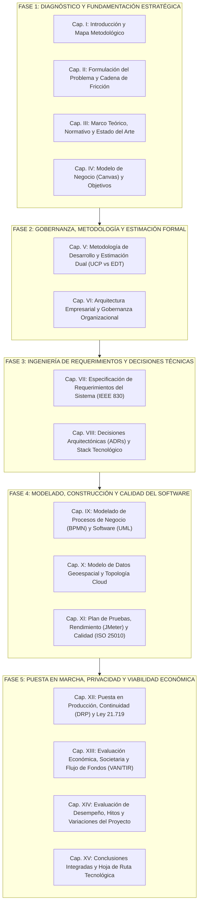

# Arquitectura Académica Definitiva: Tesis de Grado "espaciGo"
## Superación Metodológica de las Evaluaciones Sumativas y del Modelo de Referencia

**Proyecto de Titulación:** espaciGo — Plataforma Prop-Tech B2B/B2C para Arriendo Flexible de Espacios Comerciales e Industriales  
**Autores / Equipo Fundador:** Hernán Espinoza, Anita Marchant, Erick Silva  
**Carrera:** Ingeniería en Tecnologías de Información y Ciberseguridad, INACAP Sede Santiago Centro  
**Académico Guía:** Teresa Jesús Tapia Soto  

---

## 1. Evidencia de Lectura Integral y Diagnóstico de las Evaluaciones Previas

Para estructurar una tesis académica de grado superior y no un mero "corta y pega" de semestres anteriores, se auditó exhaustivamente el contenido de cada repositorio:

### 1.1. Lo que realmente ocurrió en la Evaluación Sumativa 1 (ES1) — Calificación: 40/70
El informe original (`informe_del_proyecto_espacigo.md`, 561 líneas, junto a sus 6 anexos de más de 4.000 líneas) sufrió un castigo severo en la pauta de evaluación por 4 vicios estructurales detectados por la profesora Teresa Tapia:
1. **Colapso del cuerpo por falta de abstracción:** Se pegaron tablas completas de 236 Requerimientos Funcionales, 43 Requerimientos No Funcionales y 52 Casos de Uso dentro del cuerpo principal. El documento perdió fluidez narrativa y se convirtió en un catálogo inmanejable.
2. **Ausencia de justificación metodológica formal:** Se mencionó el uso de PMBOK e iteraciones de 16 semanas, pero sin un **cuadro comparativo multicriterio** (cuali/cuantitativo) que fundamentara científicamente por qué no usar Cascada pura, Kanban o Scrum tradicional frente a requerimientos predecibles.
3. **Diagramación UML desarticulada:** Los casos de uso no se agruparon por módulos funcionales ni con fronteras de subsistema explícitas, mezclando requerimientos no funcionales (como el cifrado de contraseñas) dentro de diagramas de casos de uso.
4. **Arquitectura empresarial incipiente:** Se limitó a un organigrama en texto ASCII y viñetas descriptivas breves, sin matriz FODA institucional ni modelado de procesos de negocio formal.

### 1.2. La riqueza técnica oculta en la Evaluación Sumativa 2 (ES2)
El informe actualizado en `/home/nandev/Documentos/projects/espaciGo/ES2` (8.734 líneas, 394 KB) y los antecedentes de `ES2PT` poseen un nivel de ingeniería de software sobresaliente que supera con creces a la tesis de ejemplo:
- **Persistencia Geoespacial Crítica:** Modelado en **PostgreSQL 18 con PostGIS 3.6** utilizando índices de exclusión temporal y espacial `GiST` (`tsrange` sobre `duracion_intervalo` y `espacio_id`) para resolver el problema matemático de **doble reserva concurrente** a nivel de motor de datos (Caso de prueba `PT-02`).
- **Arquitectura Hexagonal en Go 1.27:** Desacoplamiento estricto de Puertos y Adaptadores en el Backend Go (`net/http`, `pgx/v5`), orquestado con una capa BFF (*Backend for Frontend*) en **Next.js 16 (React 19)** con Server-Side Rendering (SSR).
- **Diccionario Físico de 110 Tablas:** Estructurado en dominios de Gobernanza, Identidad, KYC/KYB, Inmuebles, Reservas/Escrow, Contratación y Auditoría.
- **Marco Legal y Ciberseguridad (Ley N° 21.719):** Arquitectura de privacidad por diseño, derechos ARCO (Acceso, Rectificación, Cancelación, Oposición) y el protocolo de **replay anti-restauración** para garantizar que backups restaurados tras un desastre no revivan datos personales purgados legalmente.
- **Factibilidad y Presupuesto Real en Chile:**
  - Desglose mensual en la región **Google Cloud Santiago (`southamerica-west1`)** por **USD 307,72/mes** netos en fase piloto (Cloud SQL Enterprise 2 vCPU/8 GB RAM, Cloud Run para API Go, Cloud Storage y Cloud Armor WAF).
  - Constitución legal como **SpA de 3.000 acciones ordinarias** (1.000 por socio) con domicilio tributario en oficina virtual de Santiago Centro (**Oficina Express**, Ahumada 131, \$50.000/año + patente municipal de 1 UTM).
  - Códigos de actividad SII: **631200** (Portales web) y **731001** (Servicios de publicidad para destaque), bajo régimen tributario Pro Pyme General.

---

## 2. Crítica Científica a la Tesis de Ejemplo (*Busquidy*): Por qué NO debemos imitar su orden

La tesis de ejemplo analizada (558 páginas) obtuvo la aprobación de la profesora por su **orden formal aparente y exhaustividad de anexos**, pero analizada bajo la lupa de la Ingeniería de Software presenta **graves fallas de coherencia interna y diseño metodológico** que debemos superar:

```
ANOMALÍAS DE DISEÑO EN LA TESIS DE REFERENCIA ("BUSQUIDY"):
❌ 1. Fractura Temporal de la Planificación:
   Presenta el cronograma en el Capítulo V (p. 65), pero luego en el Capítulo XIV (p. 224)
   vuelve a abrir un capítulo para "Ajustar el Cronograma" y pasar de 4 a 5 iteraciones.
   Una tesis de grado final NO debe mostrar "borradores rotos" de planificación; debe presentar
   la gestión de proyectos integrada: la planificación base, la gestión de riesgos y el control
   de variaciones como un ciclo de ingeniería cerrado.

❌ 2. Inversión Lógica entre Requerimientos y Arquitectura:
   En Busquidy definen la Arquitectura TI y las Herramientas en los Capítulos VI, VII y VIII,
   ¡y recién en el Capítulo IX levantan los Requerimientos bajo IEEE 830!
   En ingeniería no se define la solución técnica antes de entender el problema y los requerimientos.

❌ 3. Dispersión Arquitectónica en 3 Capítulos Aislados:
   La arquitectura está fragmentada artificialmente: Cap. VI (Arquitectura TI de los PCs de los alumnos),
   Cap. VIII (Tecnologías) y Cap. X (Arquitectura del Software). Esto confunde la infraestructura
   operativa del equipo de desarrollo con la arquitectura de la solución de software.

❌ 4. Desajustes Editoriales y Errores de Numeración:
   El Capítulo XIV está rotulado en el texto como "13. Ajustes del Cronograma", repitiendo la numeración
   del Capítulo XIII. Tablas de datos financieros fueron insertadas como imágenes y rotuladas
   como "Ilustración". Existen campos automáticos rotos como "El 0 detalla..." y contradicciones
   flagrantes entre 3 y 6 meses de plazo en el mismo informe.
```

---

## 3. Principios de la Nueva Arquitectura Académica para espaciGo

Nuestra propuesta no es un pegoteo de ES1 y ES2. Es un **tratado de ingeniería de software** con una narrativa deductiva sólida:



---

## 4. Estructura Maestra Definitiva de la Tesis de Grado (Capítulo a Capítulo)

A continuación se detalla la estructura jerárquica de 15 capítulos, diseñada para que el **Cuerpo Principal** sea analítico y ejecutivo, remitiendo fluidamente al sistema de **16 Anexos Técnicos (A al P)**.

### PRELIMINARES FORMALES (Páginas i a xli)
- **Portada Oficial INACAP:** Título completo, autores, docente guía Teresa Jesús Tapia Soto, fecha oficial.
- **Hoja de Aprobación Institucional:** Recuadro evaluativo formal con firma y calificación.
- **Dedicatoria y Agradecimientos:** Bloques individuales por cada integrante (Espinoza, Marchant, Silva).
- **Tabla de Contenido Automatizada:** Con numeración decimal uniforme hasta tercer nivel.
- **Índice de Tablas:** 1 a N (únicamente objetos de datos bidimensionales tabulares).
- **Índice de Ilustraciones:** 1 a N (diagramas BPMN, esquemas UML, topologías, capturas JMeter y Canvas).
- **Resumen Ejecutivo (Executive Summary):** 4 párrafos rigurosos: Problema de vacancia, Solución Prop-Tech (Next.js/Go/PostGIS), Métricas del Software (UCP, cobertura QA) e Indicadores Financieros (Inversión inicial, VAN, TIR, Payback).
- **Palabras Claves / Keywords:** Prop-Tech, Marketplace, Gig Economy, Arquitectura Hexagonal, PostGIS GiST, Custodia Escrow, Ley 21.719, Evaluación Económica.

---

### CAPÍTULO I: INTRODUCCIÓN Y ORGANIZACIÓN DEL TRABAJO
- **1.1. Contexto y Oportunidad Tecnológica:** El fenómeno de vacancia inmobiliaria en Chile post-pandemia y la rigidez de los modelos tradicionales de arrendamiento.
- **1.2. Propuesta de Valor de espaciGo:** Plataforma SaaS B2B/B2C para arriendos temporales on-demand con validación de identidad, firma electrónica y pago en custodia (*Escrow*).
- **1.3. Preguntas de Investigación del Proyecto:** Formulación de las interrogantes técnicas, normativas y económicas que resuelve la tesis.
- **1.4. Organización de la Tesis:** Un párrafo guía por cada capítulo subsiguiente, explicando la secuencia lógica del informe.

---

### CAPÍTULO II: IDENTIFICACIÓN Y JUSTIFICACIÓN DEL PROBLEMA
- **2.1. Diagnóstico de la Situación Actual:** Tasas de vacancia física en Santiago (12% a 14% en oficinas de Santiago Centro, 6% a 7% en bodegas industriales según CChC y Colliers).
- **2.2. Descripción del Problema y Cadena de Fricción:**
  - **Ilustración 1: Diagrama de Contexto del Ecosistema de Arriendo Flexible (As-Is vs. To-Be).**
  - Desglose de fricciones operativas: P.1 Barreras notariales y contractuales; P.2 Ineficiencia de activos desocupados; P.3 Riesgo de usurpación y morosidad.
  - **Tabla 1: Matriz de Trazabilidad Causa — Problema Central — Consecuencia de Negocio.**
- **2.3. Justificación de la Solución:**
  - *2.3.1. Relevancia Económica y Social:* Reactivación productiva de PYMEs, e-commerce y creadores independientes.
  - *2.3.2. Complejidad Multidisciplinaria:* Convergencia de geolocalización de alta precisión, conciliación de pagos con terceros y estricto apego a normativas de protección de datos.
- **2.4. Reseña de la Entidad Promotora:** Visión corporativa de la startup de base tecnológica espaciGo SpA.

---

### CAPÍTULO III: MARCO TEÓRICO, NORMATIVO Y ESTADO DEL ARTE
- **3.1. Plataformas Digitales y Modelos de Intermediación (Prop-Tech):**
  - Clasificación de modelos de Marketplace: Bilateral, Multifacético y Gig Economy de infraestructura física.
  - Benchmark de plataformas en Chile y Latinoamérica (Mercado Libre, Airbnb, Mudango, Todogalpon): análisis de brechas.
- **3.2. Mecanismos Transaccionales y Seguridad Financiera:**
  - El modelo de pago en garantía (*Escrow* / Split Payments) para mitigación de fraudes.
  - Tokenización de tarjetas y normativas PCI-DSS en pasarelas de pago.
- **3.3. Marco Regulatorio Inmobiliario y Contractual Chileno:**
  - **Ley N° 21.461 ("Devuélveme mi Casa"):** Mecanismos de restitución expedita y valor probatorio de contratos digitales.
  - **Ley N° 19.799:** Validez jurídica de la Firma Electrónica Avanzada y contratos remotos.
- **3.4. Marco Legal de Protección de Datos Personales (Ley N° 21.719):**
  - Principios rectores: licitud, lealtad, proporcionalidad y seguridad.
  - Derechos ARCO y obligaciones de notificación de incidentes de seguridad ante la Agencia de Protección de Datos.
- **3.5. Fundamentos Tecnológicos de Indexación Geoespacial:**
  - Geometría computacional sobre el elipsoide WGS84 (`SRID 4326`).
  - Árboles de búsqueda generalizada (**GiST**) para exclusión espacio-temporal sin bloqueos de tabla.
- **3.6. Implicancias para el Diseño de espaciGo:** Tabla de síntesis que vincula cada concepto teórico y legal con una decisión técnica de la plataforma.

---

### CAPÍTULO IV: MODELO DE NEGOCIO Y OBJETIVOS DEL PROYECTO
- **4.1. Formulación de la Solución y Modelo de Negocio:**
  - **Ilustración 2: Lienzo Canvas de Modelo de Negocio de espaciGo (9 bloques integrados).**
  - Modelo de monetización: Comisión porcentual (*Take-rate* del 3% neta) sobre reservas cerradas + tarifas por visibilidad destacada.
  - Alcance formal de la versión operativa y delimitación de fronteras (Restricciones del sistema).
- **4.2. Impacto en los Procesos de Negocio:**
  - Matriz resumen de Interesados (*Stakeholders*) internos y externos.  
    *(Remisión: "Para las fichas individuales de cada stakeholder, ver Anexo A || Detalle y Fichas de Interesados").*
  - Definición de Acuerdos de Nivel de Servicio (SLA) y Operacionales (OLA).  
    *(Remisión: "Las especificaciones técnicas completas se detallan en el Anexo B || Acuerdos de Niveles de Servicio").*
  - Cuadro de Mando de Indicadores Clave de Desempeño (KPIs de Negocio y Eficiencia de TI).  
    *(Remisión: "Para el catálogo de fichas SMART de cada indicador, ver Anexo D || Matriz y Fichas SMART de KPIs").*
- **4.3. Objetivos del Proyecto:**
  - *4.3.1. Objetivo General:* Formulado con taxonomía de Bloom, abarcando diseño, construcción, validación y evaluación de espaciGo.
  - *4.3.2. Objetivos Específicos:* 12 a 15 objetivos medibles que cubren todo el ciclo de vida del software.

---

### CAPÍTULO V: METODOLOGÍA DE TRABAJO, ESTIMACIÓN DUAL Y GESTIÓN
- **5.1. Selección y Justificación de la Metodología:**
  - Adopción formal de un **Enfoque Híbrido**: Ciclo de desarrollo Iterativo-Incremental gobernado por las mejores prácticas del PMBOK (7ma ed.).
  - Síntesis de la evaluación comparativa frente a Cascada, Kanban y Scrum.  
    *(Remisión: "Para revisar las matrices cualitativa y cuantitativa de evaluación metodológica, ver Anexo G || Evaluación Comparativa de Metodologías").*
- **5.2. Estimación Dual de Esfuerzo (Top-Down vs. Bottom-Up):**
  - **Estimación Formal por Puntos de Casos de Uso (UCP - Karner):** Cálculo industrial basado en los 4 actores del sistema y los 52 casos de uso, aplicando los 13 factores técnicos (TCF) y 8 ambientales (ECF).  
    *(Remisión: "La memoria de cálculo matemático en 7 pasos se encuentra en el Anexo J || Estimación de Tamaño y Esfuerzo por UCP").*
  - **Estimación Bottom-Up por Desglose de Tareas (EDT):** Esfuerzo real planificado para la construcción del MVP funcional.
  - **Justificación de la Brecha:** Contraste fundamentado entre el esfuerzo industrial total y el alcance acotado al calendario académico.
- **5.3. Estructura de Desglose del Trabajo (EDT / WBS):**  
  *(Remisión: "El árbol jerárquico completo de paquetes de trabajo se ilustra en el Anexo F || Estructura de Desglose del Trabajo").*
- **5.4. Planificación Temporal y Carta Gantt:** Fases del ciclo de vida (Iniciación, Planificación, Sprints de Construcción, Pruebas y Cierre).  
  *(Remisión: "La Carta Gantt detallada con predecesoras e hitos se presenta en el Anexo E || Carta Gantt Detallada").*
- **5.5. Organización del Equipo y Plan de Recursos (PMBOK):** Matriz RACI, estaciones de trabajo y presupuesto base valorizado.

---

### CAPÍTULO VI: ARQUITECTURA EMPRESARIAL Y GOBERNANZA ORGANIZACIONAL
- **6.1. Identidad Estratégica:** Declaración formal de Misión, Visión y Valores de espaciGo SpA.
- **6.2. Estructura Organizacional:** **Ilustración: Organigrama Jerárquico de la Startup** con separación de funciones (Dirección de Proyecto/Cloud, Desarrollo Backend/Seguridad, Arquitectura Frontend/UX).
- **6.3. Análisis Estratégico Corporativo:** **Tabla: Matriz FODA Cruzada (Fortalezas, Oportunidades, Debilidades y Amenazas)** con estrategias FO, DO, FA y DA.
- **6.4. Alineación de los 4 Dominios Arquitectónicos (TOGAF):**
  - *Arquitectura de Procesos:* Cadena de valor del servicio inmobiliario.
  - *Arquitectura de Aplicaciones:* Catálogo de componentes de frontend, backend y servicios de terceros.
  - *Arquitectura de Datos:* Gobernanza del ciclo de vida de los datos personales e inmobiliarios.
  - *Arquitectura de Infraestructura:* Cómputo serverless y base de datos gestionada en nube.

---

### CAPÍTULO VII: ESPECIFICACIÓN FORMAL DE REQUERIMIENTOS DEL SISTEMA
- **7.1. Marco Normativo y Técnicas de Levantamiento:** Estándar adoptado **IEEE 830 / 1998** y triangulación metodológica (entrevistas a corredores, encuestas a arrendatarios y análisis normativo).
- **7.2. Catálogo Resumen de Requerimientos Funcionales (RF):**
  - Presentación de la tabla consolidada en el cuerpo: dos columnas (`ID` y `Nombre del Requerimiento`), estructurada en 11 módulos funcionales (Autenticación, Perfiles, Verificación KYC, Publicaciones, Búsqueda Geoespacial, Reservas/Escrow, Contratos/Firma, Check-in/Out, Comunicación, Disputas y Administración).
  - Cumplimiento estricto de la regla docente: **un único verbo atómico por requerimiento** (`registrar`, `consultar`, `modificar`, `eliminar`, `bloquear`, `notificar`, `descargar`).  
    *(Remisión: "Para el catálogo exhaustivo con las descripciones detalladas de los 236 requerimientos funcionales atómicos, ver Anexo C || Catálogo Canónico de Requerimientos Funcionales y No Funcionales").*
- **7.3. Especificación de Requerimientos No Funcionales (RNF):** Fichas sintéticas de calidad categorizadas en Rendimiento, Seguridad, Disponibilidad, Privacidad, Mantenibilidad y Portabilidad.
- **7.4. Restricciones Técnicas y de Entorno del Proyecto:** Temporal (16 semanas), Tecnológica (Software libre y Cloud Run), Idioma (Español), Geográfica (Santiago) y Regulatoria (Leyes 21.461 y 21.719).

---

### CAPÍTULO VIII: DECISIONES DE ARQUITECTURA (ADRS) Y STACK TECNOLÓGICO
- **8.1. Metodología de Selección Multicriterio:** Aplicación sistemática de la triada de ingeniería: *a. Planteamiento del problema técnico*, *b. Opciones tecnológicas analizadas*, *c. Decisión adoptada y consecuencias*:
  1. *Backend Runtime y Lenguaje:* **Go 1.27** (`net/http`, `pgx/v5`) por rendimiento nativo, bajo consumo de memoria y concurrencia por `goroutines` frente a Node.js 22 y Java 21.
  2. *Frontend Framework:* **Next.js 16 (React 19)** con Server-Side Rendering (SSR) y patrón BFF (*Backend for Frontend*) para optimización SEO en marketplace comercial frente a Vite CSR puro.
  3. *Motor de Persistencia y Geoespacial:* **PostgreSQL 18 + PostGIS 3.6** con soporte de tipos espaciales e indexación GiST frente a MongoDB y MySQL.
  4. *Pasarela de Pagos con Custodia:* **Mercado Pago Checkout Pro** con soporte de Split de pagos para retención condicional (*Escrow*).
  5. *Servicio de Firma Electrónica:* **FirmaVirtual API** para formalización bilateral remota con validez legal según Ley 19.799.
  6. *Plataforma de Despliegue Cloud:* **Google Cloud Run** (Serverless contenerizado) en región Santiago (`southamerica-west1`) frente a Google Kubernetes Engine (GKE) y AWS Fargate.
- **8.2. Resumen Consolidado del Stack Tecnológico Implementado.**
- **Remisión obligatoria:**  
  *(Remisión: "Para revisar las matrices cualitativas y cuantitativas multicriterio y el registro completo de Decisiones de Arquitectura (ADR-001 a ADR-007), ver Anexo K || Matrices Comparativas de Tecnologías y Registros ADR").*

---

### CAPÍTULO IX: DETALLE DE LA ARQUITECTURA DE LA SOLUCIÓN
- **9.1. Modelado de Procesos de Negocio en BPMN 2.0:**
  - **Ilustración: Proceso BPMN 1 — Flujo Integral de Reserva, Custodia Financiera (Escrow), Firma Bilateral y Check-in/Out.**
  - **Ilustración: Proceso BPMN 2 — Acreditación de Identidad (KYC/KYB), Publicación Multimedia y Moderación.**
  - **Ilustración: Proceso BPMN 3 — Ejercicio de Derechos ARCO y Supresión de Datos Personales (Ley N° 21.719).**  
    *(Cada figura acompañada de su respectiva `Nota.` explicativa de un párrafo al pie).*
- **9.2. Casos de Uso del Sistema:** Diagrama general de casos de uso UML del ecosistema.  
  *(Remisiones obligatorias: "Las 52 fichas técnicas individuales de casos de uso se detallan en el Anexo H || Fichas Técnicas Detalladas de Casos de Uso" y "Los diagramas UML detallados por módulo funcional se presentan en el Anexo I || Diagramas UML de Casos de Uso por Módulo Funcional").*
- **9.3. Diagrama de Componentes de Software:** Arquitectura de micro-módulos acoplados mediante interfaces en Go.
- **9.4. Diagrama de Arquitectura de Software Hexagonal:** Patrón Puertos y Adaptadores en Backend Go y consumo vía BFF en Next.js.
- **9.5. Diagrama de Despliegue UML:** Mapeo de nodos clientes, CDN, Cloud Run y Cloud SQL en Google Cloud Platform.

---

### CAPÍTULO X: MODELO DE DATOS Y TOPOLOGÍA DE COMUNICACIONES
- **10.1. Modelado Lógico y Geoespacial de la Base de Datos:**
  - **Ilustración: Diagrama Entidad-Relación Núcleo de espaciGo (Normalizado en 3FN).**
  - Implementación del tipo `GEOMETRY(Point, 4326)` para georreferenciación de inmuebles.
  - Implementación de restricciones de exclusión GiST (`btree_gist`) sobre rangos temporales `tsrange` para prevenir dobles reservas a nivel de motor SQL sin depender de bloqueos lógicos en código.  
    *(Remisiones obligatorias: "El diccionario de datos físico completo de las 110 tablas se detalla en el Anexo L || Diccionario de Datos Físico del Esquema PostgreSQL + PostGIS" y "Los diagramas MER conceptual y lógico en gran formato se ubican en el Anexo M || Modelo de Datos Entidad-Relación y Lógico Relacional").*
- **10.2. Topología de Comunicaciones y Segmentación de Red:**
  - **Ilustración: Diagrama de Red y Topología de Comunicaciones (Desarrollo vs. Producción).**
  - Especificación técnica de protocolos, puertos, cifrado TLS 1.3, WebSockets y formato JSON/REST.
- **10.3. Diagrama de Infraestructura Cloud en Google Cloud Platform:**
  - **Ilustración: Arquitectura Cloud en Región Santiago (`southamerica-west1`).**
  - Configuración de Cloud Armor WAF, Balanceador de Carga HTTPS, VPC privada, Cloud SQL y Cloud Storage.

---

### CAPÍTULO XI: PLAN DE PRUEBAS Y ASEGURAMIENTO DE CALIDAD (QA)
- **11.1. Estrategia y Pirámide de Pruebas de Software:** Pruebas unitarias, pruebas de integración de adaptadores de persistencia y pruebas de extremo a extremo (E2E).
- **11.2. Normas y Estándares de Ingeniería de Software Aplicados:**
  - **ISO/IEC 25010:2011:** Evaluación de características de calidad del producto (Adecuación funcional, Eficiencia de desempeño, Usabilidad, Fiabilidad, Seguridad, Mantenibilidad).
  - **ISO/IEC 27001 y OWASP Top 10:** Seguridad en autenticación (Cookies HttpOnly, protección CSRF, sanitización de entradas y hashing bcrypt de contraseñas).
- **11.3. Entornos de Prueba y Criterios de Aceptación:** Definición de criterios formales de Entrada (*Code Complete*, pruebas unitarias aprobadas) y de Salida (100% de pruebas críticas aprobadas, 0 defectos bloqueantes).
- **11.4. Diseño y Ejecución de Pruebas de Rendimiento y Concurrencia:**
  - **Prueba de Carga y Concurrencia (JMeter / K6):** Simulación de solicitudes concurrentes sobre el endpoint de búsqueda geoespacial y motor de reservas.
  - **Tabla e Ilustración: Curvas de Tiempo de Respuesta y Throughput (Req/seg).**
  - Análisis de cuellos de botella en CPU, latencia de base de datos y validación de la exclusión GiST ante carreras de datos.
- **11.5. Gestión de Defectos y Ciclo de Vida de Bugs:** Clasificación de prioridades en GitHub Issues y protocolo de resolución.  
  *(Remisión obligatoria: "Para el catálogo detallado de los casos de prueba críticos PT-01 a PT-16 y las pruebas de Caja Negra, Gris, Blanca y UAT, ver Anexo O || Inventario Detallado de Casos de Prueba").*

---

### CAPÍTULO XII: PLAN DE IMPLEMENTACIÓN, OPERACIÓN Y RESILIENCIA (SRE)
- **12.1. Estrategia de Puesta en Producción (Go-Live):** Plan de despliegue progresivo, migración de esquemas en Cloud SQL y pruebas de humo (*Smoke Tests*).
- **12.2. Plan de Transferencia Tecnológica:** Capacitación a administradores en resolución de disputas y gestión documental.
- **12.3. Gestión de Disponibilidad y Resiliencia Cloud:** Definición de SLOs (99.9% de uptime) y auto-escalado horizontal de instancias serverless.
- **12.4. Plan de Continuidad del Negocio (BCP) y Recuperación ante Desastres (DRP):**
  - Metas de resiliencia: **RPO** (Pérdida máxima de datos $\le 15\text{ minutos}$) y **RTO** (Tiempo de recuperación $\le 2\text{ horas}$).
  - Matriz de riesgos operacionales y medidas proactivas/reactivas ante caídas de Cloud SQL o indisponibilidad de pasarelas de pago.
- **12.5. Gobernanza de Privacidad y Cumplimiento de la Ley N° 21.719:**
  - Protocolo técnico para el ejercicio de derechos ARCO.
  - **Arquitectura Anti-Restauración Post-DRP:** Mecanismo criptográfico y de auditoría para garantizar que al restaurar copias de seguridad de la base de datos no se restauren datos personales previamente eliminados o bloqueados por solicitud legal de los titulares.
- **12.6. Plan de Mantención y Gestión de Configuración (ITIL):**
  - Procedimiento formal de Control de Cambios (*Change Management* vía Pull Requests y CI/CD).
  - Tipologías de mantenimiento (Correctivo, Adaptativo, Perfectivo, Preventivo).  
  *(Remisión obligatoria: "Los procedimientos operativos estandarizados paso a paso ante contingencias críticas se detallan en el Anexo P || Runbooks Operacionales de Contingencia DRP y Cumplimiento Ley 21.719").*

---

### CAPÍTULO XIII: FACTIBILIDAD ECONÓMICA, SOCIETARIA Y FLUJO DE FONDOS
- **13.1. Estudio de Mercado Estratégico:**
  - Análisis PESTEL completo (Variables Políticas, Económicas, Socioculturales, Tecnológicas, Ecológicas y Legales en Chile).
  - Análisis de las 5 Fuerzas de Porter aplicado al corretaje y arriendo flexible.
  - Segmentación, Mercado Objetivo y Posicionamiento (STP).
  - Marketing Mix (Las 4P: Producto digital, Precio comisional, Plaza web y Promoción orgánica).
- **13.2. Estructura Societaria y Cumplimiento Tributario:**
  - Constitución de **espaciGo SpA con 3.000 acciones ordinarias** (1.000 acciones por fundador, 33.33% c/u) con aporte de capital inicial de \$3.000.000 CLP.
  - Formalización ante el SII: Giros **631200** (Portales web) y **731001** (Servicios de publicidad) bajo régimen Pro Pyme General.
  - Domicilio tributario en oficina virtual (Oficina Express, Ahumada 131) y patente comercial municipal de 1 UTM anual en Santiago Centro.
- **13.3. Presupuesto y Estructura de Costos del Proyecto:**
  - *Balance de Mano de Obra:* Valorización del costo de oportunidad del equipo de desarrollo a valores de mercado.
  - *Balance de Infraestructura Cloud:* Presupuesto detallado en Google Cloud Santiago (**USD 307,72/mes** en piloto, equivalente a ~\$366.192 CLP/mes con IVA).
  - *Costos Transaccionales:* Comisiones de pasarela de pago (Mercado Pago: 2.99% + IVA) y aranceles por API de firma electrónica.
  - *Gastos de Administración y Operación:* Oficina virtual, patente, contabilidad y suministros.
  - *Inversión Inicial Consolidada (Capex) y Capital de Trabajo:* Calculado mediante el método del déficit acumulado máximo para sostener la operación durante los meses iniciales sin ventas.
- **13.4. Evaluación Financiera y Flujo de Fondos Proyectado a 5 Años:**
  - Proyección de demanda y adopción de usuarios (*Funnel* de conversión y tasa de crecimiento anual CAGR).
  - Tasa de Descuento ($Ke$) calculada mediante el **Modelo CAPM** ($Ke \approx 32\% - 35\%$).  
    *(Remisión: "La memoria de cálculo del Beta Ponderado del sector software e inmobiliario según Damodaran se detalla en el Anexo N || Memoria de Cálculo de Beta Ponderado y Tasa Ke").*
  - **Tabla: Flujo de Fondos Neto Proyectado a 5 Años (Años 0 a 5).**
  - Indicadores Financieros Formales de Rentabilidad:
    - **VAN (Valor Actual Neto):** Demostración de viabilidad económica ($VAN > 0$).
    - **TIR (Tasa Interna de Retorno):** Demostración de rentabilidad superior a la tasa de descuento ($TIR > Ke$).
    - **Payback (Período de Recuperación de Inversión):** Determinación del mes exacto de retorno de la inversión.
    - **ROI (Retorno sobre la Inversión):** Rendimiento porcentual del capital invertido.

---

### CAPÍTULO XIV: EVALUACIÓN DE DESEMPEÑO, HITOS Y VARIACIONES DEL PROYECTO
- **14.1. Análisis Crítico de la Planificación Original vs. Ejecución Real:**
  - Contraste metodológico entre la línea base inicial de 16 semanas y las adaptaciones impuestas por la complejidad técnica de la solución.
  - Evaluación del cumplimiento de los hitos verificables documentales y de desarrollo (H1 a H6).
- **14.2. Gestión de Variaciones del Alcance y Lecciones Aprendidas:**
  - Análisis del desacople del motor geoespacial GiST y del flujo de pago en custodia para su estabilización en entornos de prueba antes del cierre.
  - Estrategia de control de riesgos y mitigación de deuda técnica controlada.
- **14.3. Balance Consolidado de Horas-Persona por Perfil:**
  - Tabla de horas reales ejecutadas por rol (Jefe de Proyecto/Cloud, Backend/Seguridad, Frontend/UX), cerrando el ciclo de control de recursos del PMBOK.
- **14.4. Justificación de Factibilidad Técnica del Producto Entregado:**
  - Demostración de cómo la arquitectura hexagonal en Go y la infraestructura serverless permitieron cumplir con el 100% de los requerimientos críticos dentro del marco del semestre académico.

---

### CAPÍTULO XV: CONCLUSIONES Y RECOMENDACIONES
- **15.1. Conclusiones Integradas:**
  - Síntesis analítica del éxito de la investigación en sus 4 pilares: *Técnico* (Arquitectura Go/PostGIS/Next.js probada y escalable), *Metodológico* (Enfoque híbrido validado con UCP y EDT), *Financiero* (Modelo rentable con VAN positivo y Payback justificado) y *Regulatorio* (Plataforma pionera alineada a la Ley 21.719 y Ley 21.461 en Chile).
- **15.2. Recomendaciones de Trabajo Futuro (Hoja de Ruta Tecnológica):**
  - 5 recomendaciones técnicas priorizadas para la fase de escalamiento comercial:
    1. *Prioridad Alta (Móvil):* Desarrollo de App nativa para iOS y Android (React Native) para habilitar notificaciones push y check-in/out por geocercas GPS en tiempo real.
    2. *Prioridad Alta (Ciberseguridad):* Auditoría externa de penetración (*Pentesting*) y certificación formal PCI-DSS Nivel 1 previo a la apertura bancaria masiva.
    3. *Prioridad Media (Inteligencia Artificial):* Modelos predictivos de Machine Learning para recomendación inteligente de precios según estacionalidad y demanda geográfica urbana.
    4. *Prioridad Media (Alianzas):* Integración de convenios con municipalidades y gremios de e-commerce (Cámara de Comercio de Santiago) para subsidiar la publicación de micro-bodegas.
    5. *Prioridad Baja (Integración IoT):* Integración de cerraduras electrónicas inteligentes (*Smart Locks*) mediante APIs de acceso temporal para automatizar el ingreso a recintos sin necesidad de anfitrión presencial.

---

### FUENTES DE INFORMACIÓN
- **Glosario de Términos:** Catálogo terminológico exhaustivo (A-Z) de conceptos de Ingeniería de Software, Ciberseguridad, Finanzas y Derecho Informático.
- **Referencias Bibliográficas:** Listado alfabético estricto bajo norma **APA 7ma Edición**, con sangría francesa, autores normalizados y enlaces limpios (Sommerville, Pressman, Sapag Chain, PMBOK 7ma ed., leyes publicadas en la Biblioteca del Congreso Nacional y documentación técnica de Google Cloud, PostgreSQL y Go).

---

## 5. El Catálogo Exhaustivo de los 16 Anexos Técnicos (Anexo A al P)

Para liberar al cuerpo de tablas masivas y garantizar el 100% de los puntos de la rúbrica, todo el detalle operativo se organiza en 16 anexos formalmente titulados:

| Anexo | Título Formal | Contenido Técnico Exclusivo de espaciGo |
|:---:|---|---|
| **Anexo A** | `Detalle y Fichas de Interesados` | Fichas individuales de cada stakeholder (Arrendador/Host, Arrendatario/Guest, Administrador Global, Corredores, Pasarela de Pagos, Proveedor de Firma, Entes Reguladores). |
| **Anexo B** | `Acuerdos de Niveles de Servicio (SLA) y Operacionales (OLA)` | Fichas técnicas completas: SLA-01 (Disponibilidad 99.9%), SLA-02 (Latencia Geoespacial < 300 ms), SLA-03 (Seguridad de Fondos en Custodia), OLA-01 (Soporte Nivel 1/2) y OLA-02 (Mantenimiento Preventivo). |
| **Anexo C** | `Catálogo Canónico de Requerimientos Funcionales y No Funcionales` | Catálogo completo de los **236 RFs atómicos** (un verbo por requerimiento) y los **43 RNFs** categorizados bajo estándar IEEE 830. |
| **Anexo D** | `Matriz y Fichas SMART de Indicadores Clave de Gestión (KPI)` | Fichas SMART con método de cálculo, perspectiva, fórmula matemática, metas (Óptimo, Tolerable, Deficiente) y periodicidad de revisión. |
| **Anexo E** | `Carta Gantt Detallada por Fases e Iteraciones` | Capturas gráficas en alta resolución de la Carta Gantt general y por fases, con tabla WBS completa de actividades, responsables, duraciones y predecesoras. |
| **Anexo F** | `Estructura de Desglose del Trabajo (EDT / WBS)` | Diagrama en árbol jerárquico de la EDT/WBS descompuesto formalmente en paquetes de trabajo entregables. |
| **Anexo G** | `Evaluación Comparativa de Metodologías de Desarrollo` | Tabla cualitativa y tabla cuantitativa ponderada evaluando 5 metodologías (Cascada, Iterativa-Incremental, Kanban, Lean Startup, XP). |
| **Anexo H** | `Fichas Técnicas Detalladas de Casos de Uso` | Fichas técnicas completas de los **52 Casos de Uso** (ID, Actor, Referencias cruzadas a `RF-xx`, Precondiciones, Flujo Principal paso a paso, Flujos Alternativos numerados, Postcondiciones y Excepciones). |
| **Anexo I** | `Diagramas UML de Casos de Uso por Módulo Funcional` | **11 Diagramas UML sectorizados** por cada módulo del sistema con sus límites de subsistema rotulados. |
| **Anexo J** | `Estimación de Tamaño y Esfuerzo por Puntos de Casos de Uso` | Memoria de cálculo en 7 pasos (Karner): UAW (Actores), UUCW (Casos de Uso), UUCP, Factores Técnicos TCF (T1-T13), Factores Ambientales ECF (E1-E8), Puntos Ajustados UCP y cálculo de Horas-Hombre totales. |
| **Anexo K** | `Matrices Comparativas de Tecnologías y Registros ADR` | Tablas comparativas multicriterio cuali/cuantitativas + los **7 Registros de Decisiones de Arquitectura (ADR-001 a ADR-007)** con Contexto, Opciones, Decisión y Consecuencias. |
| **Anexo L** | `Diccionario de Datos Físico del Esquema PostgreSQL + PostGIS` | Diccionario de datos exhaustivo de las **110 tablas** relacionales, especificando Columna, Tipo de Dato SQL, Restricciones (PK, FK, NOT NULL) y Descripción semántica. |
| **Anexo M** | `Modelo de Datos Entidad-Relación y Lógico Relacional` | Diagrama MER Conceptual y Esquema Lógico Relacional normalizado en 3FN en alta resolución, destacando tipos `GEOMETRY` e índices GiST. |
| **Anexo N** | `Memoria de Cálculo de Beta Ponderado y Tasa Ke (CAPM)` | Desglose sectorial de coeficientes Beta desapalancados según Damodaran, cálculo del Beta Mixto ponderado y formulación de la tasa de costo de capital ($Ke$). |
| **Anexo O** | `Inventario Detallado de Casos de Prueba` | Fichas técnicas de los casos de prueba críticos (**PT-01 a PT-16** y pruebas funcionales de Caja Negra, Gris, Blanca y UAT), con Prerrequisitos, Datos de Entrada, Procedimiento y Resultados Esperados. |
| **Anexo P** | `Runbooks Operacionales de Contingencia DRP y Cumplimiento Ley 21.719` | Procedimientos operativos estandarizados (**RB-01 a RB-06**) ante caídas de base de datos, fallas de pasarela, fugas de seguridad, rollbacks y runbooks de ejercicio de derechos ARCO. |

---

## 6. Cuadro de Solución: Cómo esta Estructura blinda el Proyecto ante la Comisión Evaluadora

| Observación Histórica de la Profesora / Falencias de Tesis Anteriores | Solución de Ingeniería Aplicada en esta Estructura para espaciGo |
|---|---|
| **"El informe parece un catálogo aburrido de requerimientos" (Nota 40/70 en ES1).** | El Capítulo VII solo contiene la síntesis ejecutiva; los 236 requerimientos atómicos y 52 casos de uso se trasladan íntegramente a los **Anexos C, H e I**. |
| **"Usan PMBOK sin justificar por qué no usan metodologías ágiles".** | El Capítulo V y el **Anexo G** incorporan una evaluación formal comparativa de 5 metodologías con puntuaciones ponderadas. |
| **"En la tesis de ejemplo la planificación está rota en dos capítulos (Cap. V y XIV)".** | En espaciGo la planificación se presenta como un ciclo cerrado: Planificación base en el Cap. V y Control de Desviaciones/Lecciones aprendidas en el Cap. XIV, sin capítulos duplicados. |
| **"El modelo de datos no resuelve problemas de concurrencia reales".** | El Capítulo X y el Anexo M documentan la implementación de **índices de exclusión GiST en PostgreSQL 18**, demostrando cómo se evita la doble reserva a nivel de motor físico. |
| **"La evaluación económica es un ejercicio teórico sin sustento chileno".** | El Capítulo XIII modela la constitución real de una **SpA con 3.000 acciones**, giros SII 631200/731001, cotizaciones en oficina virtual de Santiago Centro y tarifas oficiales de **Google Cloud Santiago (`southamerica-west1`)**. |
| **"No se aborda la nueva ley de datos personales en plataformas de software".** | Los Capítulos III, X, XII y el Anexo P incorporan la arquitectura de cumplimiento de la **Ley N° 21.719**, incluyendo el protocolo anti-restauración post-backups. |
