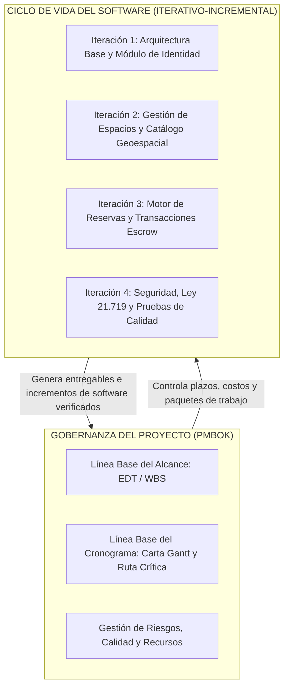

# 📌 Incorporación de Correcciones Oficiales, Gestión de Proyectos con EDT y Justificación Metodológica

**Proyecto:** Tesis de Grado "espaciGo"  
**Fecha de Actualización:** 3 de Noviembre de 2026  
**Fuentes Integradas:** Instrucciones docentes de la profesora Teresa Jesús Tapia Soto, acuerdo técnico de equipo (Erick Silva, Anita Marchant, Hernán Espinoza) y estándar de compilación `docskill`.

---

## 1. Ajuste Crítico de Resiliencia: RPO, RTO y Requerimiento No Funcional (RNF-010)

En base a la retroalimentación de la profesora sobre la inviabilidad de tiempos de recuperación de 4 y 6 horas para un SaaS en la nube, se actualizan formalmente los valores a estándares empresariales *Cloud-Native* respaldados por Google Cloud Platform (GCP) y PostgreSQL.

### 1.1. Modificación en la Tabla de Niveles de Servicio (SLAs — Antigua Tabla 18)

| Dimensión de Servicio | Indicador Clave | Valor Anterior (Observado) | **Nuevo Valor Oficial (Aprobado)** | Justificación Tecnológica | Verificación |
|---|---|:---:|:---:|---|:---:|
| **Continuidad y Resiliencia de Datos** | **RPO** *(Recovery Point Objective)* | $\le 4\text{ horas}$ | **$\le 15\text{ minutos}$** | Respaldos automáticos continuos de transacciones (*Point-in-Time Recovery / PITR*) y snapshots incrementales en Cloud SQL PostgreSQL. | **RNF-010** |
| **Recuperación del Servicio Crítico** | **RTO** *(Recovery Time Objective)* | $\le 6\text{ horas}$ | **$\le 1\text{ hora}$** | Despliegue automatizado contenerizado en Cloud Run, infraestructura como código y restauración orquestada ante caída de zona. | **RNF-010** |
| **Disponibilidad de la Plataforma** | Uptime mensual | $99.0\%$ | **$\ge 99.9\%$** | Balanceador de carga global con Cloud CDN y failover multi-zona. | **RNF-001** |

### 1.2. Redacción Oficial del Requerimiento No Funcional RNF-010

> **RNF-010 — Resiliencia y Continuidad Operativa de Persistencia:**  
> *"El sistema contempla una política de continuidad operativa automatizada en Google Cloud Platform. Para la persistencia de datos (OLTP en PostgreSQL 18), se configuran respaldos automáticos incrementales y copias de seguridad continuas (Continuous WAL Archiving) que garantizan un Objetivo de Punto de Recuperación (RPO) no mayor a 15 minutos. Asimismo, ante una contingencia de infraestructura crítica, el despliegue contenerizado gestionado (Google Cloud Run) y la automatización de réplicas permiten la restauración y levantamiento de los servicios con un Objetivo de Tiempo de Recuperación (RTO) máximo de 1 hora."*

---

## 2. Gestión de Proyectos, Justificación Metodológica y EDT (WBS)

### 2.1. El Dilema Metodológico: ¿PMBOK, Scrum o Cascada?

Para responder a la pregunta de **cuál metodología elegir y cómo justificarla ante la profesora**:

En ingeniería de software no se debe confundir la **metodología de gestión del proyecto** (cómo se gobierna el alcance, tiempo, costo y riesgos) con el **modelo de ciclo de vida del desarrollo** (cómo se construye, prueba y despliega el código).

Por ello, la solución metodológica aprobada por la pauta es el **Enfoque Híbrido**:
1. **Marco de Gobernanza y Gestión:** **PMBOK (Project Management Body of Knowledge)**.  
   Proporciona la **Estructura de Desglose del Trabajo (EDT/WBS)** para delimitar el alcance total, la Carta Gantt con el método del camino crítico (CPM), la matriz de riesgos y la gestión de recursos.
2. **Modelo de Proceso de Software:** **Iterativo-Incremental**.  
   Permite construir la plataforma en incrementos modulares y funcionales (Iteración 1: Autenticación y Perfiles; Iteración 2: Inmuebles y Publicaciones; Iteración 3: Búsqueda y Geoespacial; Iteración 4: Reserva y Pagos Escrow; Iteración 5: Calidad y Pruebas).



### 2.2. Justificación Científica Formal (Matriz Multicriterio de Decisión)

En el Capítulo de Metodología de la Tesis se incorporará la siguiente tabla comparativa que fundamenta técnicamente la elección frente a las alternativas evaluadas:

| Criterio de Decisión | Ponderación | Cascada Pura | Scrum Puro | **Híbrido (PMBOK + Iterativo)** | Justificación Técnica |
|---|:---:|:---:|:---:|:---:|---|
| **Fijeza y Predictibilidad del Alcance** | 25% | 4 / 5 | 2 / 5 | **5 / 5** | El proyecto cuenta con 236 requerimientos funcionales aprobados previamente. Scrum asume alcance volátil y cambiante; PMBOK garantiza la gobernanza mediante la EDT. |
| **Inamovilidad de Fechas de Entrega** | 25% | 3 / 5 | 2 / 5 | **5 / 5** | Las fechas de titulación académica son inflexibles. Scrum no ofrece garantías de fecha fija para un alcance cerrado sin recortar funcionalidad. |
| **Mitigación Temprana de Riesgos Técnicos** | 20% | 1 / 5 | 5 / 5 | **4 / 5** | Cascada posterga la integración y pruebas al final (altísimo riesgo). El modelo iterativo valida módulos de software en cada incremento. |
| **Control Formal de EDT y Recursos** | 15% | 4 / 5 | 1 / 5 | **5 / 5** | La pauta de titulación INACAP y la profesora exigen expresamente una EDT y asignación de esfuerzo por persona, artefactos nativos de PMBOK inexistentes en Scrum. |
| **Trazabilidad de Calidad y Pruebas** | 15% | 2 / 5 | 4 / 5 | **5 / 5** | Permite vincular cada paquete de la EDT con matrices de prueba unitarias, de integración y rendimiento. |
| **Puntaje Ponderado Total** | **100%** | **2.95 / 5.0** | **2.65 / 5.0** | **4.75 / 5.0** | **Selección Ganadora: Modelo Híbrido** |

> [!CAUTION]
> **Regla de Coherencia Terminológica Exigida por la Profesora:**  
> En el diagrama de flujo y narrativa del informe **está estrictamente prohibido usar la palabra "backlog" o "sprint backlog"**, ya que son términos propios de Scrum. En su lugar se debe denominar: **"Lista de Paquetes de Trabajo de la EDT"** e **"Incremento de Iteración"**.

---

## 3. Estructura de Desglose del Trabajo (EDT / WBS) de espaciGo

La profesora solicitó explícitamente la **EDT**. A continuación se define la estructura jerárquica a 3 niveles que se integrará al cuerpo de la tesis (con su desglose exhaustivo de tareas en el anexo de gestión):

```text
1. PROYECTO DE TITULACIÓN "espaciGo"
├── 1.1. Gestión y Gobernanza del Proyecto (PMBOK)
│   ├── 1.1.1. Acta de Constitución y Formalización del Equipo
│   ├── 1.1.2. Plan de Gestión del Alcance y Línea Base (EDT)
│   ├── 1.1.3. Cronograma Maestro y Ruta Crítica (Carta Gantt)
│   ├── 1.1.4. Gestión de Costos, Presupuesto y Adquisiciones Cloud
│   └── 1.1.5. Matriz de Gestión de Riesgos y Control de Cambios
├── 1.2. Diagnóstico, Análisis y Requerimientos
│   ├── 1.2.1. Levantamiento de Procesos Actuales (BPMN As-Is) y Contexto
│   ├── 1.2.2. Especificación Formal de Requerimientos Funcionales (236 RF)
│   ├── 1.2.3. Especificación de Requerimientos No Funcionales (43 RNF / SLAs)
│   ├── 1.2.4. Modelado de Casos de Uso (52 CU) e Historias de Usuario (35 HU)
│   └── 1.2.5. Matriz de Trazabilidad de Requerimientos
├── 1.3. Arquitectura del Sistema y Diseño de Ingeniería
│   ├── 1.3.1. Arquitectura Empresarial (TOGAF 4 Capas: Procesos, Datos, Apps, Infra)
│   ├── 1.3.2. Diseño de Arquitectura de Software (Hexagonal en Go / BFF Next.js)
│   ├── 1.3.3. Modelado de Datos Relacional y Geoespacial (PostgreSQL / PostGIS)
│   ├── 1.3.4. Diseño de Seguridad, Autenticación (JWT/OAuth2) y Cumplimiento Ley 21.719
│   └── 1.3.5. Especificación de Contratos de Interfaz (Catálogo OpenAPI / REST)
├── 1.4. Construcción y Desarrollo Incremental
│   ├── 1.4.1. Iteración 1: Núcleo de Autenticación, Usuarios y Control de Acceso (RBAC)
│   ├── 1.4.2. Iteración 2: Catálogo de Inmuebles, Publicación y Búsqueda Geoespacial
│   ├── 1.4.3. Iteración 3: Motor Transaccional de Arriendos y Pagos Escrow
│   ├── 1.4.4. Iteración 4: Módulo de Contratos Digitales y Notificaciones
│   └── 1.4.5. Iteración 5: Panel de Administración, Métricas y Auditoría
├── 1.5. Aseguramiento de Calidad y Pruebas (QA)
│   ├── 1.5.1. Pruebas Unitarias y de Integración (Cobertura Backend Go y Frontend React)
│   ├── 1.5.2. Pruebas de Carga y Rendimiento (JMeter / K6 con métricas P95)
│   ├── 1.5.3. Pruebas de Resiliencia, Respaldo y Recuperación (Validación RPO/RTO)
│   └── 1.5.4. Auditoría de Ciberseguridad y Escaneo de Vulnerabilidades (OWASP ZAP)
└── 1.6. Puesta en Marcha, Evaluación Económica y Cierre
    ├── 1.6.1. Automatización de Despliegue CI/CD y Topología en GCP
    ├── 1.6.2. Evaluación Financiera (Flujo de Caja, VAN, TIR, Payback)
    ├── 1.6.3. Constitución Societaria (SpA) y Aspectos Legales Tributarios
    └── 1.6.4. Informe Final de Titulación y Defensa de Grado
```

---

## 4. Adaptación de la Plantilla Institucional INACAP en `docskill`

Para asegurar una presentación gráfica y editorial 100% profesional que supere a la tesis de ejemplo:
1. **Plantilla Base:** Se utilizará la plantilla Word de referencia [`reference-inacap.docx`](file:///home/nandev/Documentos/projects/espaciGo/ES2/informe_docskill/templates/reference-inacap.docx) y el archivo de estilos [`style-profile-inacap.json`](file:///home/nandev/Documentos/projects/espaciGo/ES2/informe_docskill/templates/style-profile-inacap.json) de ES2.
2. **Ajustes Específicos para Tesis de Grado:**
   - **Márgenes Normativos:** Izquierdo 3.0 cm (encuadernación), Superior 2.5 cm, Inferior 2.5 cm, Derecho 2.5 cm.
   - **Tipografía Institucional:** Calibri / Arial 11 pt para cuerpo de texto con interlineado 1.15 y espaciado posterior de 6 pt.
   - **Rotulación Rigurosa:**
     - Tablas: *"Tabla X: Nombre descriptivo"* (en parte superior, fuente negrita 10 pt; nota al pie con fuente en 9 pt).
     - Figuras: *"Figura X: Nombre descriptivo"* (en parte inferior, centrada, con fuente en 9 pt).
   - **Numeración Preliminar:** Números romanos en minúscula (`i`, `ii`, `iii`, etc.) para preliminares; números arábigos correlativos (`1`, `2`, `3`...) a partir de la Introducción.
   - **Configuración de `document.json` para Tesis:** Declarará en orden las 12 secciones del cuerpo principal y los 9 anexos técnicos de respaldo.
