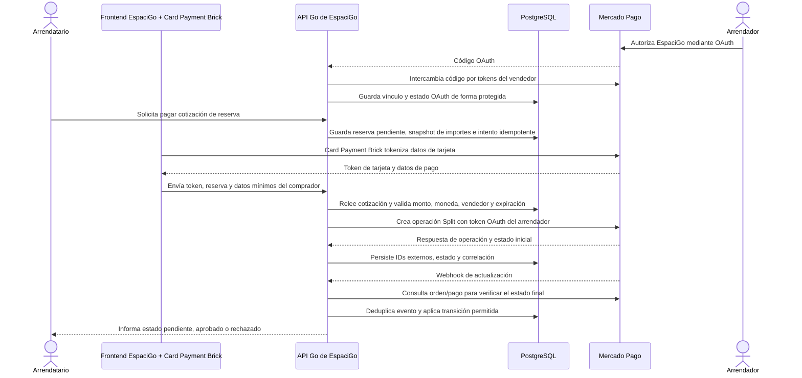

# EspaciGo: flujo de pago con Mercado Pago

**Consulta:** 29-09-2026  
**Método:** búsquedas de documentación de Chile mediante la herramienta `search_documentation` del MCP oficial de Mercado Pago.  
**Estado:** diseño técnico basado en documentación pública. No hay cuenta de vendedor habilitada, integración, transacción de prueba ni contrato de Split acreditados para EspaciGo.

## 1. Resultado de la investigación

Checkout API deja que el comprador pague dentro de EspaciGo. Para tarjetas, Mercado Pago ofrece **Card Payment Brick**, que captura los datos y entrega al frontend los datos/token necesarios para que el backend cree el pago. La aplicación no debe recibir ni almacenar el número de tarjeta o CVV.

La documentación vigente presenta **Orders API como un flujo actual de Checkout API**. Su [modelo de integración](https://www.mercadopago.cl/developers/es/docs/checkout-api-orders/integration-model) dice que Checkout API ahora procesa con Orders y describe creación automática y manual. Sin embargo, ese mismo modelo enumera Payments API y Orders API como dos alternativas; indica que Payments procesaba exclusivamente antes y que Orders es ahora otra alternativa. En la documentación pública consultada mediante MCP no apareció un aviso de discontinuación ni una fecha de retiro de Payments API. Por tanto, se confirma que Orders es una ruta vigente y central en la documentación actual de Checkout API, pero **no se confirma que Payments API esté oficialmente discontinuada**.

Para EspaciGo hay que separar la ruta de pago Checkout API actual del marketplace con Split:

| Ruta | Lo documentado | Implicancia para EspaciGo |
|---|---|---|
| Checkout API con Orders | La documentación vigente presenta Checkout API vía Orders (`POST /v1/orders`), con procesamiento automático o manual. | Es la ruta base elegida para el diseño de integración nueva de EspaciGo. Orders permite consulta, captura, cancelación y reembolso de la orden. |
| Payments API | El modelo oficial aún la enumera como una alternativa distinta de Orders para pagos online. En la documentación pública revisada no encontré aviso de deprecación/discontinuación ni fecha de sunset. | No afirmar que el endpoint está oficialmente retirado. Para un desarrollo nuevo se prefiere Orders, salvo que un flujo de Split requerido y confirmado dependa de Payments. |
| Split 1:1 para marketplace | Mercado Pago lo declara disponible en Chile. Requiere autorización OAuth por vendedor y KYC nivel 6. La guía vigente de Split dice Checkout API y muestra un cobro `POST /v1/payments` con `application_fee`; no muestra una creación de `Order` con comisión. | La documentación pública no confirma que la operación Split de esa guía se haya migrado a Orders ni el campo equivalente en una Order. Confirmar esa compatibilidad antes de fijar el endpoint de EspaciGo. |

La guía de Split señala que la tarifa de Mercado Pago se descuenta primero de los fondos del vendedor y luego se descuenta la comisión del marketplace del saldo restante. También advierte que el reembolso se distribuye proporcionalmente y que puede no ser posible devolver la parte del vendedor si no tiene saldo. No presenta Split 1:1 como custodia, garantía retenida o liberación del dinero condicionada a la finalización del arriendo.

**Decisión técnica:** diseñar la integración nueva de Checkout API de EspaciGo sobre Orders (`POST /v1/orders`). Para el caso marketplace, la ruta completa de Split 1:1 continúa pendiente de confirmación: un cobro Orders estándar no demuestra por sí mismo que el dinero se distribuya al arrendador ni que se descuente la comisión. Tampoco se debe seleccionar Payments sólo por el ejemplo publicado de Split sin confirmar su vigencia frente al aviso que el usuario vio en Developers.

## 2. Flujo objetivo para EspaciGo

Para una compra simple de Checkout API, el endpoint vigente documentado es `POST /v1/orders`. En el marketplace, el paso de creación debe seguir el endpoint de Split que Mercado Pago confirme. La documentación pública consultada sigue ejemplificando `POST /v1/payments` con `application_fee`, mientras que Orders no contiene un ejemplo publicado equivalente. El diagrama define responsabilidades; el request de Split queda abierto.

### 2.1 Incorporación del arrendador

1. Registrar qué arrendador y cuenta de Mercado Pago corresponden a la publicación, con estado de autorización separado del estado comercial del arrendador.
2. Redirigir al vendedor al flujo OAuth de autorización de Mercado Pago; usar y validar `state` para vincular la respuesta a la sesión iniciada por EspaciGo.
3. Intercambiar el `authorization_code` en el backend por `access_token` y `refresh_token`. El código es de un solo uso y tiene vigencia limitada; renovar los tokens desde el backend antes de operar cuando corresponda.
4. Cifrar y restringir los tokens del vendedor. No enviarlos al navegador, no registrarlos en logs y permitir revocar/desconectar el vínculo.
5. Verificar en pruebas y onboarding el requisito publicado de KYC 6 para la cuenta vendedora. La existencia de OAuth no acredita que la cuenta esté comercialmente habilitada para la operación deseada.

La integración Split debe utilizar la `public_key` de la cuenta integradora en el frontend y el token OAuth del vendedor en el backend. El backend nunca debe sustituirlo por el token del comprador ni por el Access Token de la cuenta integradora.

### 2.2 Reserva y cobro

1. El caso de uso de reservas valida permisos, disponibilidad, cotización aceptada, vendedor autorizado y vencimiento de la reserva.
2. En una transacción corta de PostgreSQL, crea la reserva pendiente, bloquea la ocupación según las reglas de EspaciGo y guarda un snapshot financiero inmutable. No mantiene la transacción abierta mientras llama al proveedor.
3. El frontend muestra Card Payment Brick. El Brick recoge datos de tarjeta y entrega un token de pago; el formulario de Mercado Pago reduce el manejo directo de datos de tarjeta de EspaciGo.
4. El frontend envía a la API de EspaciGo el token emitido por Mercado Pago y el identificador de reserva. El precio no se acepta desde el navegador como fuente de verdad.
5. El backend recalcula y valida el total desde el snapshot. Construye la solicitud con el token de pago, moneda, cuotas/medio admitido, referencia externa y clave de idempotencia. Para Split usa el `access_token` OAuth del vendedor y el importe de comisión aprobado, mediante el endpoint que se confirme.
6. El backend registra el resultado inicial y responde al frontend con un estado acotado. Timeout ambiguo pasa a `por_conciliar`; no se crea un cobro nuevo hasta consultar la operación previa con la misma referencia/idempotencia.

La guía de Split llama `application_fee` al importe de comisión del Checkout API en su ejemplo de `/v1/payments`. No encontré `application_fee` en el request de Orders documentado ni una instrucción para mapearlo a un campo de Orders. Esto no prueba que Orders sea incapaz de operar con Split: prueba que la documentación pública consultada aún no permite cerrar esa integración. EspaciGo debe calcular y persistir el importe acordado a partir de la regla y el snapshot de reserva.

### 2.3 Webhooks y actualización de estados

- Configurar el evento de Order para Orders o el evento correspondiente al recurso que Mercado Pago confirme para Split.
- Exponer un endpoint HTTPS y validar la firma `x-signature` con la clave secreta de Webhooks de la aplicación antes de procesar el aviso.
- Tratar el webhook como aviso para consultar el recurso; no como prueba suficiente por sí solo. Obtener la operación en Mercado Pago y comprobar IDs, monto, moneda, referencia de reserva y estado.
- Persistir el evento recibido con una clave externa única para deduplicar reintentos. Responder rápidamente y mover el procesamiento a la cola durable/outbox si requiere trabajo adicional.
- Aplicar transiciones explícitas: solo una operación verificada y acreditada puede hacer que la reserva pase a `pagada`; estados pendientes, acción requerida, fallidos y rechazados no confirman el arriendo.
- Registrar notificación, verificación, consulta, resultado y transición con IDs de correlación y datos mínimos. Evitar guardar token de tarjeta o credenciales en la auditoría.

Si no llega el webhook, la documentación permite consultar el recurso correspondiente (`GET /v1/orders/{id}` para Orders), pero recomienda las notificaciones para recibir cambios en tiempo real.

## 3. Modelo financiero que debe conservar EspaciGo

El precio y sus componentes deben persistirse de forma independiente, en CLP y vinculados a la cotización/reserva:

1. Precio bruto del arriendo del arrendador.
2. Comisión neta de EspaciGo.
3. IVA asociado a la comisión, si la determinación tributaria aplicable lo confirma.
4. Tarifa de procesamiento de Mercado Pago y su IVA, según la liquidación real.
5. Neto efectivamente recibido por el arrendador.
6. Reembolsos, contracargos y ajustes como movimientos nuevos, nunca editando el cobro original.

No contar como ingreso de EspaciGo el monto de arriendo que corresponde al vendedor. No asumir que la comisión de Mercado Pago recae económicamente en EspaciGo: la guía pública Split indica que se descuenta primero al vendedor; cualquier compensación, precio final distinto o incidencia acordada necesita confirmación contractual y tributaria. No contabilizar el saldo retenido como garantía ni prometer liberación condicionada sin un producto y contrato que lo permitan.

La propuesta backend de ES2 usa PostgreSQL como fuente operacional, un adaptador de pagos aislado y procesamiento asíncrono durable. La entidad `pago` conserva intentos idempotentes; `evento_proveedor` correlaciona callbacks, y `movimiento_financiero` separa cobro, tarifas, comisión, neto, reembolso y contracargo. La reserva y el pago mantienen máquinas de estado distintas.

## 4. Verificaciones pendientes específicas de Split

Solicitar confirmación escrita al ejecutivo o soporte técnico de Mercado Pago sobre:

1. Si la guía Split 1:1 de Checkout API con `POST /v1/payments` sigue vigente para nuevas integraciones chilenas y cómo se relaciona con la indicación de Payments que el usuario vio en Developers.
2. Si Split 1:1 ya permite **Checkout API vía Orders** (`POST /v1/orders`). Pedir el endpoint y esquema vigentes para incluir la comisión marketplace en una Order, con un ejemplo actualizado de request y respuesta.
3. Si el comprador paga con tarjeta emitida fuera de Mercado Pago bajo ese Split, además del límite documentado para transferencias externas o dinero en cuenta.
4. Cómo se identifican la orden, pago, vendedor y comisión en webhooks, reportes de ventas y conciliación.
5. Cómo se hacen reembolsos totales/parciales y contracargos cuando el vendedor no conserva saldo suficiente.
6. Qué cuenta de prueba debe crear el integrador, cómo autorizar vendedores de prueba, y qué condiciones de KYC/KYB aplican a una futura SpA y sus arrendadores.
7. Tarifas, IVA, responsable de cada cargo y plazo/liberación de comisión. La guía dirige configuraciones de liberación a una cuenta comercial asesorada.
8. Si hay custodia o retención condicional disponible para el tipo de arriendo. No inferirla de Split 1:1.

Hasta obtener respuesta, los puntos 1–8 quedan como cuestiones abiertas de proveedor; las pruebas locales pueden cubrir idempotencia, máquinas de estado y webhooks simulados, pero no demuestran compatibilidad, liquidación o aprobación de Mercado Pago.

La revisión de la documentación pública no encontró una fecha ni declaración de retiro de Payments API. La tabla comparativa de Mercado Pago la sigue enumerando y afirma que Orders es otra alternativa para procesar Checkout API. Si Developers mostró un aviso de retiro, debe tratarse como evidencia nueva por contrastar —posiblemente una comunicación de producto/cuenta no incluida en la documentación indexada— antes de declarar una fecha o transición obligatoria.

## 5. Plan de implementación incremental

1. **Sandbox de una cuenta:** crear reserva y snapshot; integrar Brick; implementar el adaptador del endpoint estándar confirmado; persistir respuesta, estados y referencia. Mantenerlo separado del Split productivo.
2. **Notificaciones:** configurar Webhook, verificar firma, deduplicar, consultar la operación y aplicar transiciones de reserva con eventos repetidos y fuera de orden.
3. **Marketplace/OAuth:** implementar consentimiento vendedor, callback `state`, intercambio/renovación protegida de tokens y desconexión. Solo avanzar cuando se haya confirmado endpoint, país, condiciones y cuentas de prueba para Split.
4. **Conciliación/reversos:** conciliar los cinco importes del modelo; probar aprobada, rechazada, pendiente, timeout, doble envío, doble webhook, reembolso parcial/total, saldo insuficiente y contracargo.
5. **Salida:** usar credenciales productivas solo después de aprobación expresa del equipo, revisión de proveedor/contador y ensayos sandbox registrados. Esta investigación no acredita que la integración esté implementada ni lista para producción.

## 6. Fuentes primarias consultadas mediante MCP

- Mercado Pago, [Checkout API vía Orders API: descripción](https://www.mercadopago.cl/developers/es/docs/checkout-api-orders/overview).
- Mercado Pago, [modelo de integración y diferencias entre Payments API y Orders API](https://www.mercadopago.cl/developers/es/docs/checkout-api-orders/integration-model).
- Mercado Pago, [integración de pagos con tarjetas y Card Payment Brick](https://www.mercadopago.cl/developers/es/docs/checkout-api-orders/payment-integration/cards).
- Mercado Pago, [referencia para crear una Order](https://www.mercadopago.cl/developers/es/reference/online-payments/checkout-api/create-order/post).
- Mercado Pago, [notificaciones para Orders y validación de origen](https://www.mercadopago.cl/developers/es/docs/checkout-api-orders/notifications).
- Mercado Pago, [estados de transacción](https://www.mercadopago.cl/developers/es/docs/checkout-api-orders/payment-management/status/transaction-status).
- Mercado Pago, [Split de Pagos 1:1: disponibilidad y alcance](https://www.mercadopago.cl/developers/es/docs/split-payments/split-1-1/overview).
- Mercado Pago, [requisitos previos de Split 1:1](https://www.mercadopago.cl/developers/es/docs/split-payments/split-1-1/prerequisites).
- Mercado Pago, [integrar Checkout en Split 1:1](https://www.mercadopago.cl/developers/es/docs/split-payments/split-1-1/integration-configuration/integrate-marketplace).
- Mercado Pago, [OAuth: autorización y renovación de tokens](https://www.mercadopago.cl/developers/es/docs/security/oauth).
- Mercado Pago, [reembolsos y cancelaciones para Orders](https://www.mercadopago.cl/developers/es/docs/checkout-api-orders/payment-management/refunds-cancellations).

## Base interna de diseño (no es fuente de afirmaciones externas)

- [Propuesta de backend ES2](propuesta_backend_final.md): Go modular, PostgreSQL, adaptador de pagos, idempotencia, sandbox y conciliación.
- [Anexo B, diccionario de datos](../anexos/B_diccionario_datos.md): entidades `reserva`, `pago`, `evento_proveedor` y `movimiento_financiero`.
- [INV-026, investigación previa de Split y condiciones](INV-026_mercado_pago_split.md): evidencia recopilada antes de esta búsqueda MCP; sus pendientes continúan abiertos.

La investigación actual **amplía** la descripción técnica del flujo y **mantiene abierta** la compatibilidad exacta entre Split 1:1 y Orders API. No convierte una documentación pública en habilitación comercial, oferta tarifaria, prueba ejecutada ni decisión de producto aprobada.
